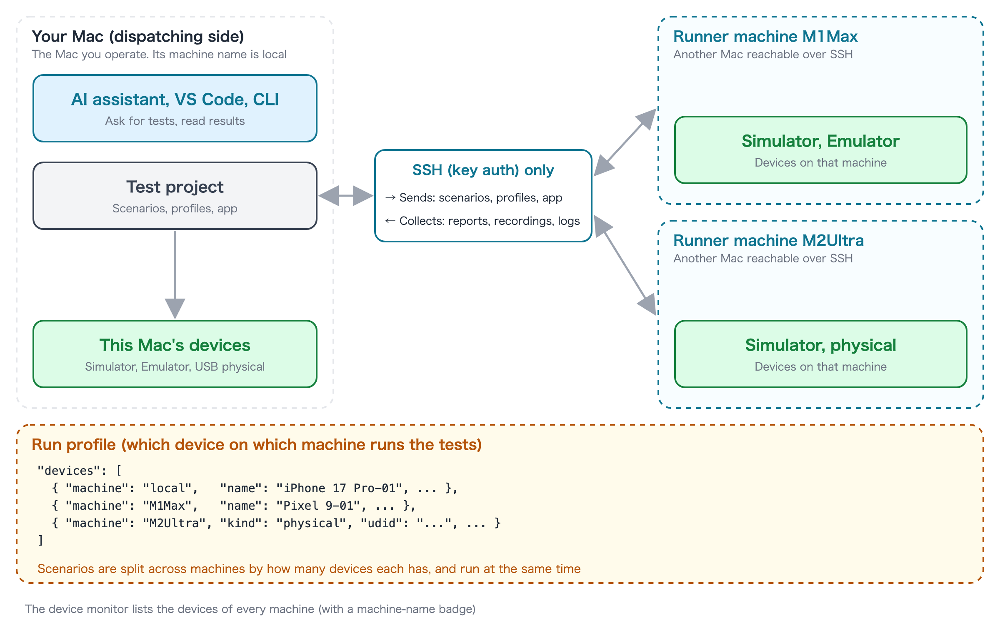

# Fleet concepts

[in Japanese(日本語)](concepts_ja.md)

In fleetest, the set of devices (virtual devices and physical devices) that run your tests is called a **fleet**.
You can grow your fleet by adding devices on local and remote Macs.



## The pieces

| Name | Description |
|---|---|
| Your Mac | The Mac you operate. You ask for tests from an AI assistant, VS Code or the CLI, and read the results here. Its machine name is `local` |
| Runner machine | Another Mac that runs tests for you. It does not need to be on the same LAN, as long as your Mac can log in to it over SSH |
| Machine name | A name you give a runner machine on your Mac (for example `M1Max`). Profiles use this name, not a host name or IP address |
| Device | Where the tests run: Simulators and Emulators (virtual devices) and physical devices (a real iPhone or Android). Every device belongs to one machine |
| Run profile | The setting that decides which devices on which machines run the tests. Each device has its machine name in `machine` |

## Machine names

To point at a runner machine, you use a name you give it on your Mac, not its host name or IP address.
This name is called the **machine name**.

- **Host**: the real network destination. Example: `<user@192.168.xxx.xxx>`
- **Machine**: a name for that host, known only on this Mac. Example: `M1Max`. This is what
  profiles refer to.

Register machine names with `fleetest remote machines add` or in the Device Monitor's Settings
tab (see Step 2 of [Adding a Mac](adding_mac.md)).

Renaming a machine later causes no trouble. Records such as result JSON keep the host name, and
the machine name never appears in the files or arguments sent to the runner.

## The run profile decides where tests run

The devices listed in a run profile's `devices` are where the run goes. Each device names its own machine in
`machine`, so **choosing a run profile also chooses which Macs run the tests**.

```jsonc
// profiles/runs/ios-m1max.json
{ "app": "myapp",
  "devices": [
    { "platform": "ios", "machine": "M1Max", "name": "iPhone 17 Pro", "osVersion": "iOS 27.0", "model": "iPhone 17 Pro" }
  ] }
```

- If every device is on one runner machine, the run is sent to that runner machine, and you normally do not need
  `--runner`.
- If the devices are split between your Mac and runner machines (or several runner machines), scenarios are split
  across machines by how many devices each has, and run at the same time. Each portion runs against its own devices
  there.
- Physical devices work the same way. List a device with `"kind": "physical"` and its identifier, with the `machine`
  of the Mac it is connected to.
- Write `"machine": "local"` for devices on your own Mac — always write it explicitly, since
  there is no profile-level default to fall back on.
- `--runner <name>` on the command line takes priority over the profile (pass `--runner local` to
  force a run to stay on your Mac). Besides a machine name, `--runner` also accepts a host name
  or IP address directly.
- When you narrow a run with `--device <name>` and devices with that name exist on **more than one
  machine** (you use the same names on your Mac and on a runner), fleetest cannot tell which machine
  you mean, so the run is refused. Add `--runner local` for your Mac only, `--runner <machine>` for one
  machine, or `--all-machines` to run on every machine that has a device with that name. If the name
  is on only one machine, the run goes ahead as before.

To run the same scenarios on every machine, create a **fleet definition** that lists pairs of a machine and a run
profile (`TestProjects/<project>/profiles/fleets/<name>.json`) and run `fleetest run --fleet <name>` (`--split`
splits the scenarios across the machines instead of running all of them everywhere; see "Run it" in [Remote Runners](remote_runners.md)).

## What happens automatically

- **Sending**: scenarios, profiles and the app are sent from your Mac to the runner machines on every run. You edit
  only on your Mac and never touch the files on a runner machine.
- **Collecting**: reports, JUnit, recordings and logs are collected back to your Mac and included in `fleetest results`
  (flaky detection and so on).
- **Watching**: the device monitor in the VS Code extension lists the devices of every machine just like your own
  (with a machine-name badge).
- **Keeping versions aligned**: before a run, fleetest checks that the runner machine has the same fleetest version as
  your Mac. If they differ, the run does not start.

The only connection is **SSH (key authentication) from your Mac to the runner machines**. Your Mac never needs to
accept incoming connections.

## Overview

```
Your Mac                                Runner machine
fleetest run --runner mac2 …             ~/fleetest-runner/               ← dedicated base directory
  ├ version check (fleetest, Xcode)  ssh ├── foundation-tester/          ← clone of fleetest itself (fixed name, shared)
  ├ send (scenarios/config) ───────────> └── users/<issuerId>/work/     ← your work area (per user)
  ├ display output                             ├── TestProjects/<project>/
  └ collect artifacts <──────────────────      └── .build/
```

Remote runs only use `~/fleetest-runner/` on the runner. If the runner has its own copy of
foundation-tester elsewhere, it is never touched.

## What it can do

| Capability | Supported |
|---|---|
| Send a run to another Mac (from the CLI or the VS Code extension) | ✅ |
| Progress display, cancellation, timeout | ✅ |
| Bring reports, JUnit, recordings and run logs back to your Mac | ✅ |
| Provision a runner from your Mac in one command (`remote setup`); remove it the same way (`remote teardown`) | ✅ |
| Check or clean up several runners at once (`remote status` / `remote clean`) | ✅ |
| Run a single `fleetest` command on a runner (`remote exec`) | ✅ |
| Run on several runners at the same time (a fleet, `run --fleet`) | ✅ |
| Split one set of scenarios across several runners (`run --fleet <name> --split`) | ✅ |
| Include remote results in `fleetest results` (flaky detection etc.) | ✅ (collected by default) |
| See remote devices' state and video in the Device Monitor | ✅ |

## How to grow it

| What you want | What to add | How |
|---|---|---|
| Run more devices at once so the whole suite finishes sooner | A Mac | [Adding a Mac](adding_mac.md) |
| Share one large Mac across a team | A Mac | Set it up in [Adding a Mac](adding_mac.md); how to use it is in "Sharing one runner between several people" in [Remote Runners](remote_runners.md) |
| Check on real hardware | Physical devices | [Adding physical devices](adding_physical_devices.md) |
| Connect physical devices to another Mac and run them there | A Mac and physical devices | Add the Mac first, then connect the devices to it |

How many Simulators and Emulators one Mac can run at once depends on its memory and CPU. When adding devices to
one Mac starts to slow things down, it is time to add a Mac.

## Good to know

- **A runner machine runs only one run at a time.** While someone is using it, other runs wait until it is free
  ("Sharing one runner between several people" in [Remote Runners](remote_runners.md)).
- **Keep a user logged in on each runner machine.** A Mac sitting at the login window cannot run tests.
- **You can take a machine out temporarily.** Clear "Machine enabled" under "Machines" in the device monitor's
  Settings tab, and no tests are sent to that machine.

## Related

- [Adding a Mac](adding_mac.md) — preparing a runner machine and adding it to the fleet
- [Adding physical devices](adding_physical_devices.md) — adding a real iPhone or Android to the fleet
- [Remote Runners](remote_runners.md) — running on a runner machine (`--runner`, `--fleet`, the VS Code extension, sharing), plus setups across a router, maintenance and safety

### Link
- [index](../index.md)
