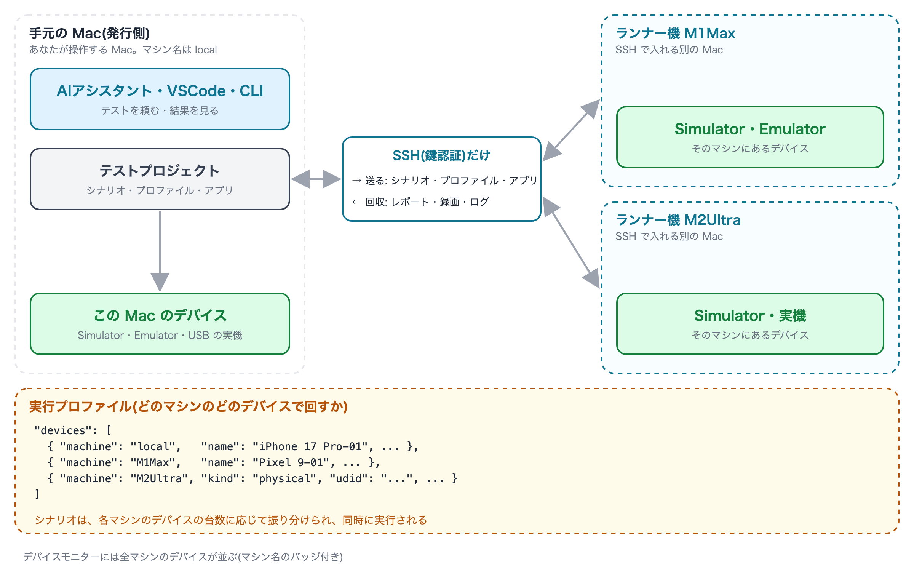

# フリートの考え方

[in English](concepts.md)

fleetest では、テストを実行するデバイス(仮想デバイス、実機)の集まりを**フリート**と呼びます。ローカルおよびリモートの Mac の
デバイスを追加することで、フリートを増強することができます。



## 登場するもの

| 名前 | 説明 |
|---|---|
| 手元の Mac | あなたが操作する Mac です。AIアシスタント・VSCode・CLI からテストの実行を指示し、結果もここで見ます。マシン名は `local` です |
| ランナー機 | テストを実行させる別の Mac です。手元の Mac から SSH でログインできれば、同じ LAN になくても構いません |
| マシン名 | ランナー機に手元で付ける名前(例: `M1Max`)です。プロファイルにはホスト名や IP アドレスではなく、この名前を書きます |
| デバイス | テストを動かす端末です。Simulator・Emulator(仮想デバイス)と、実機(本物の iPhone / Android)があります。どれも、どれかのマシンに属します |
| 実行プロファイル | どのマシンのどのデバイスでテストを回すかを決める設定です。デバイスごとに `machine` にマシン名を書きます |

## マシン名

ランナー機を指すときは、ホスト名や IP アドレスではなく、手元で付けた名前を使います。この名前を**マシン名**と呼びます。

- **ホスト(host)**: ネットワーク上の実際の宛先です。例: `<user@192.168.xxx.xxx>`
- **マシン(machine)**: そのホストに付ける、この Mac の中だけで通じる名前です。例: `M1Max`。
  プロファイルに書くのはこちらです。

マシン名は `fleetest remote machines add` か、デバイスモニターの「設定」タブで登録します
(手順は[Mac を追加する](adding_mac_ja.md)のステップ2)。

マシン名はあとから変えても困りません。結果 JSON などの記録にはホスト名が残り、
ランナー機へ送るファイルや引数にもマシン名は出てこないためです。

## どこで実行されるかは実行プロファイルで決まる

実行プロファイルの `devices` に並んだデバイスが、そのまま実行先になります。デバイスごとに `machine` にマシン名を
直接書くので、**実行プロファイルを選べば、どの Mac で実行するかも決まります**。

```jsonc
// profiles/runs/ios-m1max.json
{ "app": "myapp",
  "devices": [
    { "platform": "ios", "machine": "M1Max", "name": "iPhone 17 Pro", "osVersion": "iOS 27.0", "model": "iPhone 17 Pro" }
  ] }
```

- デバイスが全部1台のランナー機に載っていれば、run はそのランナー機へ送られます。ふだんは `--runner` を付ける必要は
  ありません。
- 手元とランナー機(あるいは複数のランナー機)に分かれていれば、シナリオはマシンごとのデバイスの台数に応じて振り分けられ、
  同時に実行されます。それぞれ自分のデバイスに対して実行されます。
- 実機も同じです。`"kind": "physical"` と端末の識別子を書いたデバイスを、つないだ Mac の `machine` で並べます。
- 手元の Mac のデバイスには `"machine": "local"` と書きます。既定は無いので、デバイスごとに必ず明示してください。
- コマンドラインで `--runner <名前>` を付けると、プロファイルの指定より優先されます
  (`--runner local` を付ければ手元だけで実行させられます)。`--runner` にはマシン名のほか、
  ホスト名や IP アドレスを直接書くこともできます。
- `--device <名前>` で実行するデバイスを絞るとき、その名前のデバイスが**複数のマシンにある**
  (手元とリモートで同じ名前を使っている)と、どのマシンで回すかを決められないので、実行は断られます。
  手元だけなら `--runner local`、特定のマシンだけなら `--runner <マシン名>`、その名前のデバイスがある
  全部のマシンで回すなら `--all-machines` を付けてください。名前が1台のマシンにしか無ければ、そのまま回ります。

全マシンで同じシナリオを流したいときは、マシンと実行プロファイルの組を並べた**フリート定義**
(`TestProjects/<プロジェクト>/profiles/fleets/<名前>.json`)を作り、`fleetest run --fleet <名前>` で実行します
(`--split` を付けると、同じシナリオを全マシンで回す代わりに振り分けます。[リモート実行](remote_runners_ja.md)の「回す」)。

## 自動で行われること

- **送る**: シナリオ・プロファイル・アプリは、実行のたびに手元からランナー機へ送られます。編集は手元だけで行い、
  ランナー機のファイルを直接触ることはありません。
- **回収する**: レポート・JUnit・録画・ログは手元へ回収され、`fleetest results` の集計(flaky の検出など)にも入ります。
- **見る**: VSCode 拡張のデバイスモニターには、全マシンのデバイスが手元のものと同じように並びます(マシン名のバッジ付き)。
- **版を揃える**: 実行の前に、ランナー機の fleetest が手元と同じ版かを確かめます。ずれていれば実行は始まりません。

ランナー機との通信は、手元からランナー機への **SSH(鍵認証)だけ**です。手元の Mac が外から接続を受ける必要はありません。

## 全体像

```
手元の Mac                               ランナー機
fleetest run --runner mac2 …             ~/fleetest-runner/               ← 専用ベースディレクトリ
  ├ 版の確認(fleetest・Xcode)   ssh     ├── foundation-tester/          ← fleetest 本体のクローン(名前固定・共有)
  ├ 送信(シナリオ・設定) ──────────>  └── users/<issuerId>/work/      ← あなたの作業場所(利用者ごと)
  ├ 出力を受け取って表示                     ├── TestProjects/<プロジェクト>/
  └ 成果物を回収 <───────────────────      └── .build/
```

リモート実行で使うのは、ランナー機の `~/fleetest-runner/` の中だけです。
ランナー機に foundation-tester が別に入っていても、それには一切触りません。

## できること

| できること | 対応 |
|---|---|
| 別の Mac へ run を送って実行する(CLI・VSCode 拡張のどちらからでも) | ✅ |
| 実行中の進み具合の表示・キャンセル・タイムアウト | ✅ |
| レポート・JUnit・録画・run ログを手元へ回収する | ✅ |
| ランナー機の導入を手元から1コマンドで行う(`remote setup`)。撤去も1コマンド(`remote teardown`) | ✅ |
| 複数のランナー機をまとめて診断・掃除する(`remote status` / `remote clean`) | ✅ |
| ランナー機で `fleetest` のコマンドを1つだけ実行する(`remote exec`) | ✅ |
| 複数のランナー機で同時に実行する(フリート。`run --fleet`) | ✅ |
| 1組のシナリオを複数のランナー機に振り分ける(`run --fleet <名前> --split`) | ✅ |
| リモートで実行した結果も `fleetest results` の集計(flaky 検出など)に含める | ✅(既定で回収) |
| 拡張の「デバイスモニター」タブで、リモートのデバイスの状態と映像を見る | ✅ |

## どう広げるか

| やりたいこと | 足すもの | 手順 |
|---|---|---|
| 同時に回す台数を増やして、テスト全体を速く終わらせたい | Mac | [Mac を追加する](adding_mac_ja.md) |
| チームで1台の大きな Mac を共有したい | Mac | [Mac を追加する](adding_mac_ja.md)で用意し、使い方は[リモート実行](remote_runners_ja.md)の「1台のランナー機を複数人で使うとき」 |
| 本物の端末で確かめたい | 実機 | [実機を追加する](adding_physical_devices_ja.md) |
| 実機を別の Mac につないで、そちらで回したい | Mac と実機 | Mac を追加してから、その Mac に実機をつなぐ |

同時に動かせる Simulator・Emulator の台数は、その Mac のメモリと CPU で決まります。1台の Mac で台数を増やして
遅くなってきたら、Mac を足す頃合いです。

## 知っておくこと

- **1台のランナー機で同時に動く run は1つだけ**です。誰かが使っている間は、空くまで待ちます
  ([リモート実行](remote_runners_ja.md)の「1台のランナー機を複数人で使うとき」)。
- **ランナー機にはログインしたままにしておきます**。ログイン画面で止まっている Mac ではテストを動かせません。
- **マシンを一時的に外せます**。デバイスモニターの「設定」タブの「マシン」で「マシン有効」を外すと、そのマシンへは
  テストを振り分けません。

## 関連

- [Mac を追加する](adding_mac_ja.md) —— ランナー機を用意して、フリートに入れる手順
- [実機を追加する](adding_physical_devices_ja.md) —— 本物の iPhone / Android をフリートに入れる手順
- [リモート実行](remote_runners_ja.md) —— ランナー機で回す手順(`--runner`・`--fleet`・VSCode 拡張・複数人での共有)と、ルーター越しの構成・保守・安全

### Link
- [index](../index_ja.md)
