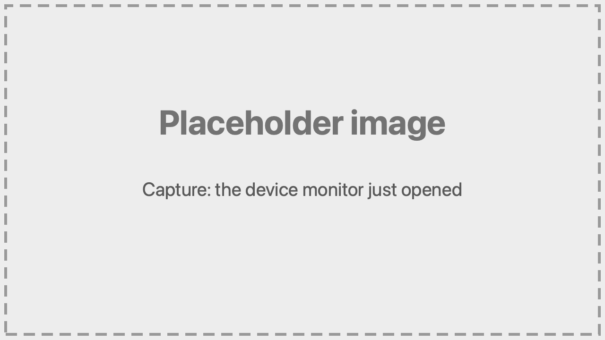
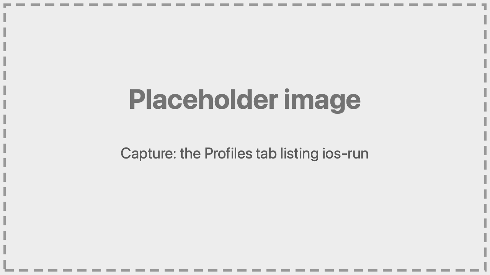
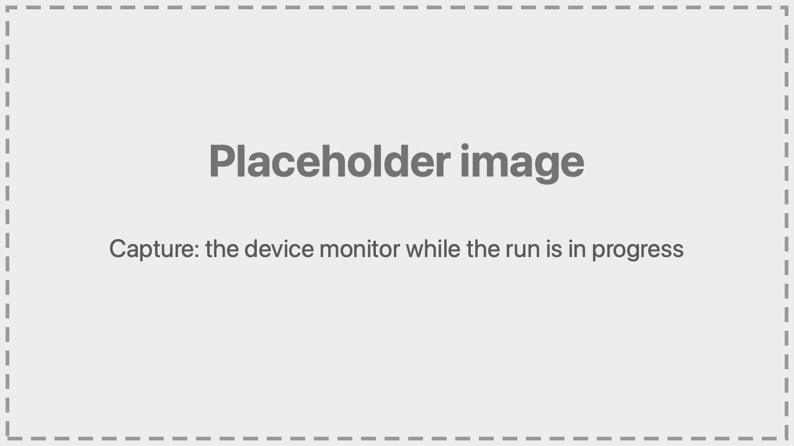
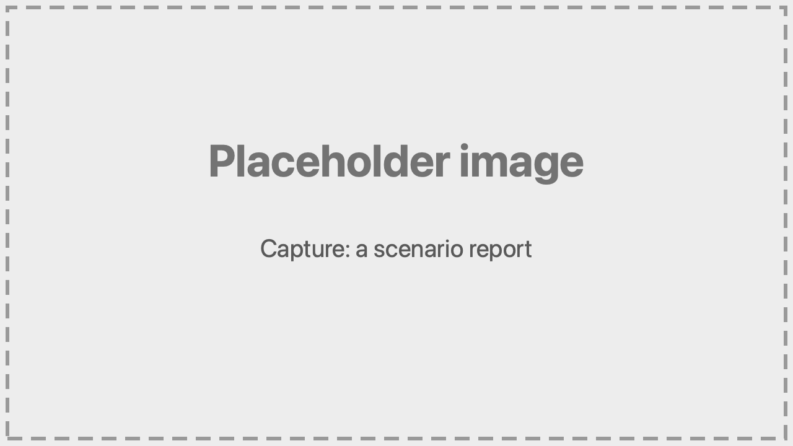

# Quick Start

[in Japanese(日本語)](quick-start_ja.md)

The shortest path from installing fleetest to creating scenarios for a sample app and running them.
You do not write scenarios by hand.

## 1. Environment

fleetest runs on a Mac with Apple silicon and macOS 26+. For details, see [Environment](overview/environments.md).

## 2. Before you start

Install the following.

- **Xcode 26+**
  - <https://apps.apple.com/app/xcode/id497799835>
  - After installing it, launch the Xcode app once and finish downloading its components.
- **Homebrew**
  - <https://brew.sh/>
- **VSCode**
  - <https://code.visualstudio.com/docs/setup/mac>
- **Android SDK (adb, Command-line Tools)** (if you test Android)
  - <https://developer.android.com/studio/install>
- **AI assistant (Claude Code, etc.)**
  - Install an AI assistant that supports MCP. Claude Code and Codex can be installed as VSCode extensions.

## 3. Installing fleetest

1. Create a **new, test-only folder** in Finder

2. Open the folder you created in VSCode

3. Start your AI assistant (the Claude Code extension, for example) and give it this instruction:

```text
Clone https://github.com/wave1008/foundation-tester next to this folder, then set it up by
following ../foundation-tester/.claude/skills/fleetest-setup/SKILL.md.
```

4. If you use an **AI assistant other than Claude Code**, the setup asks whether to register the MCP server; choose to register it.

5. When the installation finishes, restart VSCode.

6. Click **fleetest mobile** in the status bar at the lower-left corner of VSCode. The device monitor opens.

   

7. Ask your AI assistant to "run fleetest doctor and report the result", and confirm that no errors are reported

## 4. Preparing the sample app

Prepare the sample app
([sut-ec-mobile](https://github.com/wave1008/sut-ec-mobile), a Compose Multiplatform shopping app)
and declare its server to fleetest. The server is built with Kotlin (Ktor) and PostgreSQL.

### Prompt for the AI

```text
Clone https://github.com/wave1008/sut-ec-mobile next to this folder, then run bash ../sut-ec-mobile/fleetest/prepare.sh in this folder.
```

<details>
<summary><b>If you do it manually (click to show details)</b></summary>

Run these in your work folder:

```bash
git clone https://github.com/wave1008/sut-ec-mobile.git ../sut-ec-mobile
bash ../sut-ec-mobile/fleetest/prepare.sh
```

To use a different test project name, pass it like `bash ../sut-ec-mobile/fleetest/prepare.sh <name>`.

</details>

## 5. Prepare the profiles

Create the app profile and the run profile.

### Prompt for the AI

For iOS:

```text
Build the sut-ec-mobile iOS app and create its profiles. The app's display name is "SUT Store". Use two devices.
The build needs JDK 25; if it is missing, you can install JDK 25 with Homebrew. Don't modify any shell configuration files.
```

For Android:

```text
Build the sut-ec-mobile Android app and create its profiles. The app's display name is "SUT Store". Use two devices.
The build needs JDK 25; if it is missing, you can install JDK 25 with Homebrew. Don't modify any shell configuration files.
```

<details>
<summary><b>If you do it manually (click to show details)</b></summary>

Build the app in the sut-ec-mobile folder:

```bash
# iOS Simulator (set the name in -destination to a Simulator you have)
xcodebuild -project iosApp/iosApp.xcodeproj -scheme iosApp -configuration Debug \
  -sdk iphonesimulator -destination 'platform=iOS Simulator,name=iPhone 17 Pro' \
  -derivedDataPath build/ios-sim CODE_SIGNING_ALLOWED=NO ARCHS=arm64 ONLY_ACTIVE_ARCH=YES build
#   -> build/ios-sim/Build/Products/Debug-iphonesimulator/iosApp.app

# Android
./gradlew :androidApp:assembleDebug
#   -> androidApp/build/outputs/apk/debug/androidApp-debug.apk
```

Go back to your work folder and run the following. The installation creates no test project, so create one first
(when you ask the AI assistant, it is created automatically; the VSCode extension also creates it on startup after VSCode restarts).

```bash
../foundation-tester/.build/debug/fleetest project create project1

# iOS
../foundation-tester/.build/debug/fleetest profile setup --platform ios --app-id com.sutec.mobile.ios --auto-device --app-name "SUT Store" \
  --app-path ../sut-ec-mobile/build/ios-sim/Build/Products/Debug-iphonesimulator/iosApp.app

# Android
../foundation-tester/.build/debug/fleetest profile setup --platform android --app-id com.sutec.mobile.android --auto-device --app-name "SUT Store" \
  --app-path ../sut-ec-mobile/androidApp/build/outputs/apk/debug/androidApp-debug.apk
```

Without `--app-name` the name defaults to the project name, which differs from the icon name on the home screen and produces a warning at the start of a run.
Passing the built app to `--app-path` makes the run install it on the device automatically.
`--auto-device` picks a Simulator/Emulator with the newest iOS runtime and the newest Pixel (and creates it
when missing; a missing iOS runtime is downloaded first: several GB, several minutes to tens of minutes;
one that is not running is started automatically at run time). The app profiles are named `ios-app` and `android-app`, and the
run profiles `ios-run` and `android-run`. These commands register one device; add the second one with "Add device" on the
"Profiles" tab of the VSCode extension's device monitor.

</details>
<br>

When it succeeds, the AI assistant reports the name of the run profile (such as `ios-run`), and that run profile is listed on the "Profiles" tab of the VSCode device monitor.



See [Profiles](./reference/project/profiles.md) for the details.

## 6. Create the scenarios

Let's create exploratory tests for the login screen.

### Prompt for the AI

```text
Create exploratory tests on iOS for just the login screen of sut-ec-mobile (SUT Store). Put the step that switches the app to English mode in setUpDevice. Stop once you've told me the file name of the new scenario.
```

`setUpDevice` is where you put the preparation that is done once per device before the tests (here, switching the language).
For Android, read "on iOS" as "on Android".

The AI assistant launches the app on a device, reads the elements of the login screen while
operating it, and turns the behavior it finds into scenarios.
Before exploring, the AI assistant starts the server declared in compose.yaml with `ft_services`.

<details>
<summary><b>If you do it manually (click to show details)</b></summary>

Start the server by hand, explore, and stop it when you are done.

```bash
../foundation-tester/.build/debug/fleetest services up --profile ios-run
../foundation-tester/.build/debug/fleetest services down --profile ios-run
```

</details>

## 7. Run it on a device

Let's run the scenarios you created.
On every run fleetest starts the server and stops it when the run ends. Services you started beforehand are taken over.

### Prompt for the AI

```text
Run the scenarios you created on iOS.
```

For scenarios created on Android, ask "Run them on Android" instead.



<details>
<summary><b>If you do it manually (click to show details)</b></summary>

```bash
../foundation-tester/.build/debug/fleetest run --profile ios-run
```

`--profile` takes the name of the run profile from step 5 (`ios-run`, or `android-run` for Android).
The app, the devices, and the run-time settings are all resolved from it.

From VSCode, open the **Test Explorer**, pick the scenario, and click **Run**.
Before the first run, choose the run profile to use (for example `ios-run`) with `fleetest: Select Run Profile` in the
Command Palette. Without one, the run does not start and shows an error.

</details>

## 8. Read the results

Every run writes a Markdown report per scenario to `TestProjects/<project>/reports/`.



When a run fails, the server's log is kept at `TestProjects/<project>/results/runs/<month>/<runID>/services/server.log`.

Let's summarize the reports and analyze the errors.

### Prompt for the AI

```text
Summarize the results of that run. If anything failed, use the report to find out why.
```

<details>
<summary><b>If you do it manually (click to show details)</b></summary>

Open the report in `reports/`. In VSCode, the Test Explorer shows pass/fail on each test, and you
can open the report from there.

</details>

## 9. Troubleshooting

If you run into a problem, ask your AI assistant. Common symptoms and how to narrow them down are
collected in [Troubleshooting](in_action/troubleshooting.md).

Next: [Asking the AI assistant](tutorial/asking_ai.md)

### Link
- [index](index.md)
