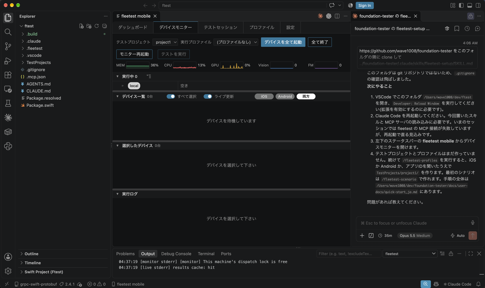
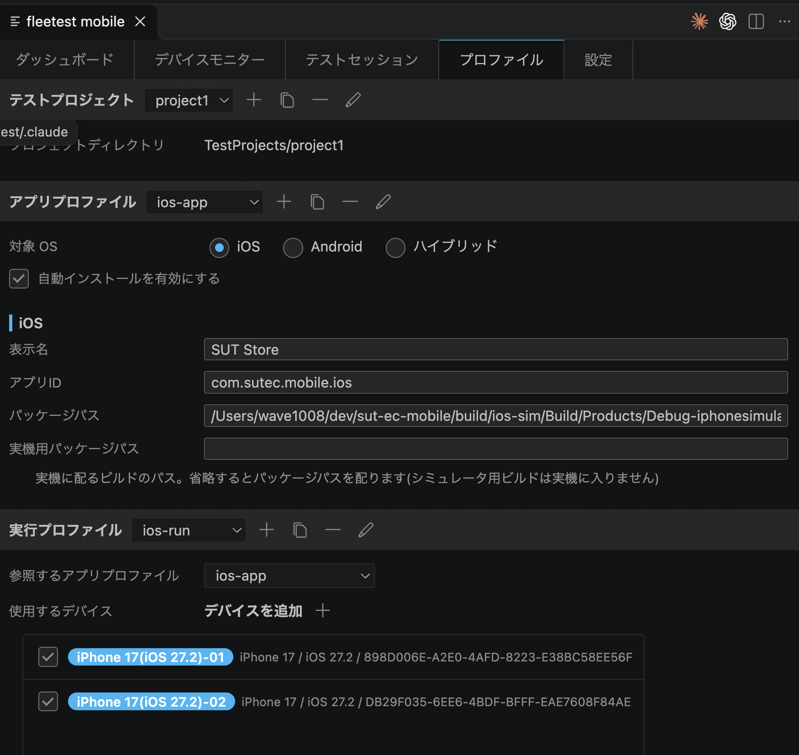
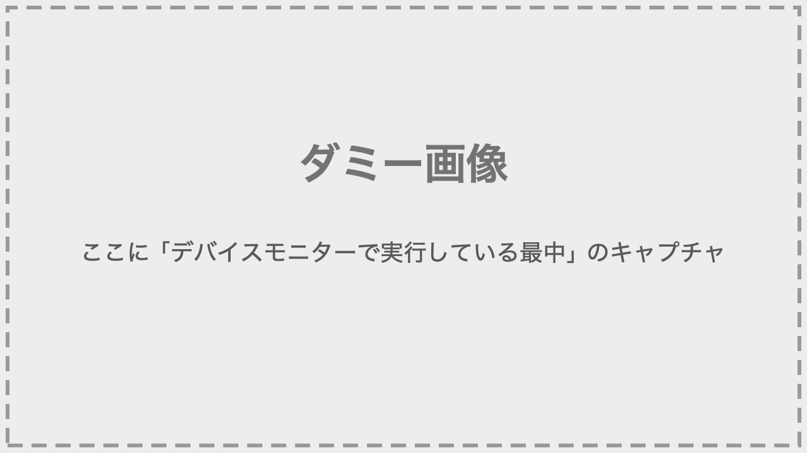
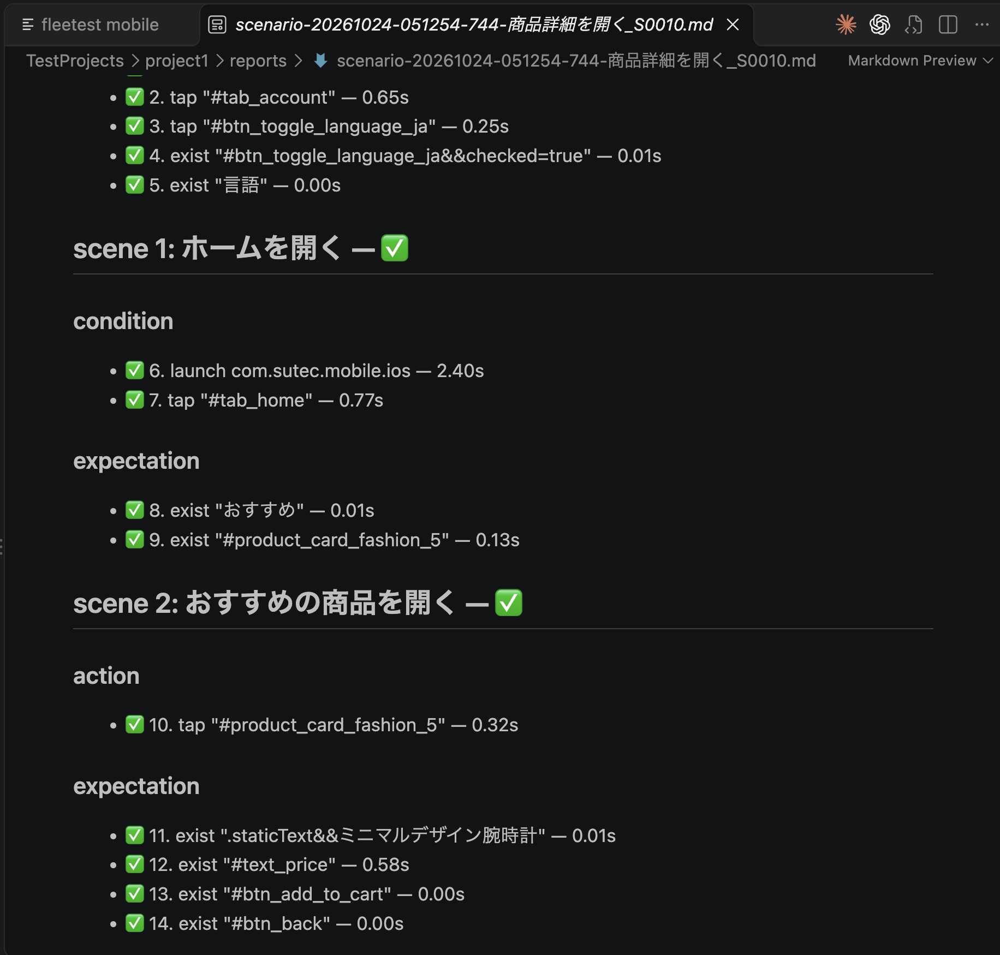

# クイックスタート

[in English](quick-start.md)

fleetest をインストールし、サンプルアプリを対象にテストシナリオを作って実行するまでの最短手順です。

## 1. 環境

本ツールは Apple silicon の Mac、macOS 26+ で動作します。環境の詳細は[環境](overview/environments_ja.md)を参照してください。

## 2. 事前準備

以下をインストールしてください。

- **Xcode 27.2+**
  - <https://apps.apple.com/jp/app/xcode/id497799835>
  - インストールしたら Xcode のアプリを一度起動し、コンポーネントのダウンロードを済ませてください。
- **Homebrew**
  - <https://brew.sh/ja/>
- **VSCode**
  - <https://code.visualstudio.com/docs/setup/mac>
- **Android SDK(adb・Command-line Tools)**(Android をテストする場合)
  - <https://developer.android.com/studio/install?hl=ja>
- **AIアシスタント(Claude Code など)**
  - MCP に対応した AIアシスタントをインストールしてください。Claude Code や Codex の場合は VSCode 拡張からインストールできます。

## 3. fleetest のインストール

1. Finder で**テスト専用の新規フォルダ**を作成します

2. 作成したフォルダを VSCode で開きます

3. AIアシスタント(Claude Code 拡張など)を起動して次のように指示します（所要時間：約5分）

```text
https://github.com/wave1008/foundation-tester をこのフォルダの隣に clone して
../foundation-tester/.claude/skills/fleetest-setup/SKILL.md の手順でセットアップして。
```

4. **Claude Code 以外の AIアシスタント**を使う場合は、セットアップの途中で MCP を登録するか聞かれるので、登録してください

5. インストールが完了したら、VSCode を再起動します

6. VSCode の左下のステータスバーに表示される **fleetest mobile** をクリックします。デバイスモニターが開きます

   

7. AIアシスタントへ次のように指示し、エラーが出ないことを確かめます

```text
../foundation-tester/.build/debug/fleetest doctor を実行して結果を報告して。
```

## 4. サンプルアプリの準備

サンプルアプリ
([sut-ec-mobile](https://github.com/wave1008/sut-ec-mobile)。Compose Multiplatform の EC 買い物アプリ)を
セットアップします。

### AIへの指示文

```text
https://github.com/wave1008/sut-ec-mobile をこのフォルダの隣に clone して、このフォルダで bash ../sut-ec-mobile/fleetest/prepare.sh を実行して。
```

<details>
<summary><b>手動で実行する場合(クリックで詳細表示)</b></summary>

作業フォルダで実行します。

```bash
git clone https://github.com/wave1008/sut-ec-mobile.git ../sut-ec-mobile
bash ../sut-ec-mobile/fleetest/prepare.sh
```

テストプロジェクトの名前を変えるときは、`bash ../sut-ec-mobile/fleetest/prepare.sh <名前>` のように渡します。

</details>

## 5. プロファイルを用意する

アプリプロファイルと実行プロファイルを作成します。

### AIへの指示文

iOS の場合:

```text
fleetest のテストプロジェクト project1 に、sut-ec-mobile の iOS アプリをビルドしてプロファイルを作成して。アプリの表示名は「SUT Store」。デバイスは2台にして。
ビルドには JDK 25(Homebrew の openjdk@25。/opt/homebrew/opt/openjdk@25)を使って。シェルの設定ファイルは変更しないで。
```

Android の場合:

```text
fleetest のテストプロジェクト project1 に、sut-ec-mobile の Android アプリをビルドしてプロファイルを作成して。アプリの表示名は「SUT Store」。デバイスは2台にして。
ビルドには JDK 25(Homebrew の openjdk@25。/opt/homebrew/opt/openjdk@25)を使って。シェルの設定ファイルは変更しないで。
```

<details>
<summary><b>手動で実行する場合(クリックで詳細表示)</b></summary>

sut-ec-mobile のフォルダでアプリをビルドします。ビルドには JDK 25 を使います(ステップ4の prepare.sh が Homebrew の openjdk@25 を入れます)。

```bash
export JAVA_HOME=/opt/homebrew/opt/openjdk@25

# iOS Simulator
xcodebuild -project iosApp/iosApp.xcodeproj -scheme iosApp -configuration Debug \
  -sdk iphonesimulator -destination 'generic/platform=iOS Simulator' \
  -derivedDataPath build/ios-sim CODE_SIGNING_ALLOWED=NO ARCHS=arm64 ONLY_ACTIVE_ARCH=YES build
#   -> build/ios-sim/Build/Products/Debug-iphonesimulator/iosApp.app

# Android
./gradlew :androidApp:assembleDebug
#   -> androidApp/build/outputs/apk/debug/androidApp-debug.apk
```

作業フォルダに戻って実行します。プロファイルは、ステップ4で作られたテストプロジェクト project1 に作られます。

```bash
# iOS
../foundation-tester/.build/debug/fleetest profile setup --platform ios --app-id com.sutec.mobile.ios --auto-device --count 2 --app-name "SUT Store" \
  --app-path ../sut-ec-mobile/build/ios-sim/Build/Products/Debug-iphonesimulator/iosApp.app

# Android
../foundation-tester/.build/debug/fleetest profile setup --platform android --app-id com.sutec.mobile.android --auto-device --count 2 --app-name "SUT Store" \
  --app-path ../sut-ec-mobile/androidApp/build/outputs/apk/debug/androidApp-debug.apk
```

`--app-name` を省略するとプロジェクト名になり、ホーム画面のアイコン名と食い違って実行の開始時に警告が出ます。
`--app-path` にビルドしたアプリを渡すと、実行時にデバイスへ自動でインストールされます。
`--auto-device` は、最新の iOS ランタイムと最新の Pixel を使う Simulator/Emulator を自動で選びます
(足りなければ作成します。iOS のランタイムが未導入のときは数 GB をダウンロードするので数分〜数十分かかります。
起動していないものは実行時に自動で起動します)。アプリプロファイルの名前は `ios-app`・`android-app`、実行プロファイルの名前は `ios-run`・`android-run` になります。
`--count 2` は、その実行プロファイルの該当 OS のデバイスを全部で2台にします(同じ内容の既存デバイスは番号の小さい順に再利用し、足りない分を作ります。指示文の「デバイスは2台にして」と同じです)。あとから VSCode 拡張のデバイスモニターの「プロファイル」タブにある「デバイスを追加」でも足せます。

</details>
<br>

VSCode のデバイスモニターの「プロファイル」タブを開き、アプリプロファイルと実行プロファイルが作成されたことを確認します。



## 6. シナリオを作る

商品を開くまでの基本ルートのテストを作成してみましょう。

### AIへの指示文

```text
fleetest のテストプロジェクト project1 で、SUT Store の「商品詳細を開くテスト」を iOS で1本作成して。ファイル名は 商品詳細を開く.swift にして。
ホームから商品を1つ開いて商品詳細が表示されるまでの基本ルート(正常に進む流れ)を確かめる。アプリを日本語モードに切り替える処理は setUpDevice に書いて。
シナリオのファイル名を報告したら終わりにして。
```

- MCPの許可ダイアログが表示された場合は許可してください。
- `setUpDevice` は、テストの前にデバイスごとに1回だけ行う準備を書く場所(関数)です。
- Android の場合は「iOS で」を「Android で」に読み替えてください。
- AIアシスタントはデバイス上でアプリを起動し、画面を操作しながら要素を読み取って、その流れをシナリオに落とします。

<details>
<summary><b>手動で実行する場合(クリックで詳細表示)</b></summary>

サーバーを手で起こしてからテストを作り、終わったら止めます。

```bash
../foundation-tester/.build/debug/fleetest services up --profile ios-run
../foundation-tester/.build/debug/fleetest services down --profile ios-run
```

</details>

## 7. デバイスで実行する

作成したシナリオを実行してみましょう。

### AIへの指示文

```text
fleetest のテストプロジェクト project1 のシナリオを ios-run プロファイルで実行して。
```

- MCPの許可ダイアログが表示された場合は許可してください。

※Android で作ったシナリオなら「android-run プロファイルで実行して」と指示します。



<details>
<summary><b>手動で実行する場合(クリックで詳細表示)</b></summary>

```bash
../foundation-tester/.build/debug/fleetest run --profile ios-run
```

`--profile` には、ステップ5で用意した実行プロファイルの名前(`ios-run`。Android なら `android-run`)を渡します。
アプリ・デバイス・実行時設定はそこから解決されます。

VSCode からは **Test Explorer** でシナリオを選び、**実行**をクリックします。
初めて実行する前に、コマンドパレットの `fleetest: 実行プロファイルを選択` で使う実行プロファイル(例: `ios-run`)を
選んでおきます。実行プロファイルが1つしか無いときは、選ばずに実行してもそれが自動で選ばれます。

</details>

## 8. 結果を見る

実行のたびに `TestProjects/<プロジェクト>/reports/` にシナリオごとの Markdown
レポートが出ます。



失敗したときは、サーバーのログが `TestProjects/<プロジェクト>/results/runs/<月>/<runID>/services/server.log` に残ります。

レポートを要約し、エラーを分析してみましょう。

### AIへの指示文

```text
fleetest のテストプロジェクト project1 の直近の実行結果を要約し、失敗があればレポートから原因を調べて。
```

<details>
<summary><b>手動で実行する場合(クリックで詳細表示)</b></summary>

`reports/` のレポートを開きます。VSCode では Test Explorer が成否を直接表示し、そこからレポートを
開けます。

</details>

## 9. トラブルシュート

問題が起きたら AIアシスタントに相談してください。よくある症状と切り分けは
[トラブルシューティング](in_action/troubleshooting_ja.md)にまとめてあります。

<br>

次へ: [fleetest の使い方の基本](tutorial/basic_usage_ja.md)

### Link
- [index](index_ja.md)
