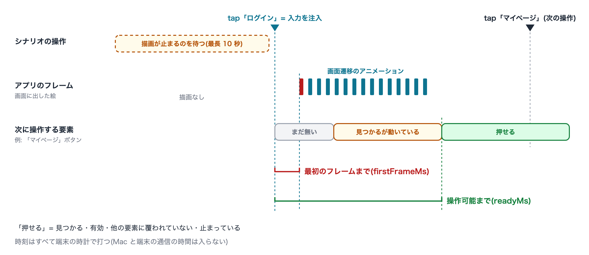
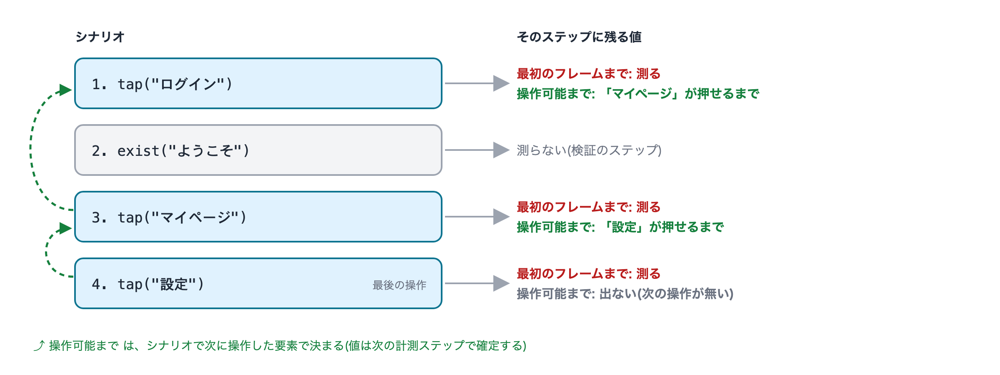
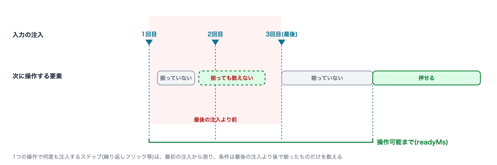

# レスポンス計測

[in English](response_measurement.md)

既存のシナリオを実機で回しながら、**操作してからアプリが反応するまで**と、**次の操作ができるようになるまで**の時間を、
ステップごとに測ります。測った値は結果に残り、同じ機械・同じ端末での前回の計測と比べられます。

> **Android か iOS の実機1台** で使えます(Simulator・Emulator は対象外)。

## 何を測るか

画面を動かす操作(`tap`・`swipe`・`scroll` など)のステップごとに、次の値を取ります。検証(`exist` など)や `select` のステップは測りません。

| 値 | 意味 |
|---|---|
| 最初のフレームまで(`firstFrameMs`) | 操作の入力を注入してから、アプリが最初のフレームを画面に出すまで |
| 操作可能まで(`readyMs`) | 操作の入力を注入してから、**次に操作した要素**が「見つかる・有効・他の要素に覆われていない・止まっている」状態になるまで |

時刻はすべて端末の時計で打つので、Mac と端末のあいだの通信の時間は入りません。




**操作可能まで**は、シナリオで実際に次に操作した要素で決めます。たとえば「ログイン」をタップした次に「マイページ」をタップする
シナリオなら、「ログイン」の値は「タップしてから、マイページのボタンが押せる状態になるまで」です。




## 有効にする

実行プロファイル(`profiles/runs/<name>.json`)に `responseMeasurement: true` を書きます。

```json
{
  "app": "my_app",
  "devices": [
    { "platform": "android", "name": "Pixel 8", "kind": "physical", "serial": "XXXXXXXX" }
  ],
  "responseMeasurement": true,
  "responseRepeat": 5
}
```

プロファイルを書き換えずに1回だけ試すなら、`--set` で上書きできます。

```sh
fleetest run --profile <name> --set responseMeasurement=true --set responseRepeat=3 --scenario <シナリオID>
```

- **使うデバイスはちょうど1台で、Android か iOS の実機(`kind: physical`)** でなければなりません。条件を満たさないと実行を断ります。
  デバイスが複数あるプロファイルでは、`--device <名前>` で1台に絞ります(この Mac につないだデバイスなら `--runner local` も付けます)。

  ```sh
  fleetest run --profile <名前> --runner local --device "Pixel 8" --set responseMeasurement=true --scenario <シナリオID>
  ```
- iOS の実機では、**最初のフレームまで** を Xcode の Instruments(`xctrace`)で記録して、run の終わりに結果へ書き足します。
  Xcode が入っていて、その端末を Instruments で記録できる状態が必要です。記録できなかったときは、その旨を1行出して値を空のままにします。
- `responseRepeat`(既定 `5`、`1`〜`50`)で、各シナリオを続けて何回回すかを決めます。回数が多いほど、中央値・p90 が安定します。
  結果ファイルは `<id>`、`<id>~2`、`<id>~3`、… の名前で並びます。
- 計測の条件をそろえるため、計測モードでは次のように動きます。
  - アプリのアニメーションを残します(`enableAnimations` を強制的に有効にします)。アニメーションを止めた状態の時間は、
    利用者が感じる時間を表さないためです。
  - テキストの可視性検証(`fmTextVisibilityCheck`・`ocrTextVisibilityCheck`)・`screenLooksLike`・録画(`record`)・
    ホスト負荷による減速を止めます。
  - iOS は xcuitest モードで走ります(計測は XCUITest ブリッジにあるため。run の間 `iosMode` の既定が `xcuitest` になります)。
  - デバイスモニターの観測・配信を、run の間だけ止めます(run の終わりに戻します。自分で期限なしの `fleetest monitor pause` をしている場合は
    そのままにします。`--for` で期限付きにしている場合は run の間だけ期限なしに置き換え、終わりにまだ期限前なら元の停止に戻します)。
- 次の指定と一緒には使えません(名前付きのエラーで止まります): `enableAnimations: false`、`fmTextVisibilityCheck` /
  `ocrTextVisibilityCheck` / `screenLooksLike` / `record` を `true`、`iosMode` かデバイスの `mode` を `inapp`、`--broadcast`・`--fleet`・`--split`。

計測モードでは、操作の前に毎回「アプリの描画が止まる」のを待つので(最長 10 秒)、通常の実行より時間がかかります。

## 結果を見る

```sh
fleetest results response [--project <name>] [--since <期間>] [--json]
```

計測モードの run だけを集めて、ステップごとに並べます。

| 列 | 意味 |
|---|---|
| `scenario` / `step` | シナリオと、そのシナリオの中のステップ(シーン・区分・コマンド・説明・同じ組の何回目か で同一視) |
| `device` / `host` | 端末(serial)と、実行した機械 |
| `n` / `median ms` / `p90 ms` | 最初のフレームまでの時間の標本数・中央値・p90 |
| `busy` | 操作の前から描画が続いていて、最初のフレームを測らなかった回数(下の「値が出ないとき」) |
| `ready n` / `ready median ms` / `ready p90 ms` | 操作可能までの時間の標本数・中央値・p90 |
| `prev median ms` / `delta` | 同じ機械・同じ端末での直前の計測 run の、最初のフレームまでの中央値と、そこからの差 |

- 比べるのは、**同じ機械・同じ端末**の run どうしだけです。機械か端末が違う run とは比べません。
- 差は事実として並べるだけで、テストを失敗にはしません。少ない標本の差は、ばらつきと区別できないことがあります。
- `--json` では、行ごとに値が出ない理由の内訳(下の表の値)も出ます。

1回ごとの値は、結果 JSON(`results/runs/.../scenarios/<id>.json`)の各ステップの `response` にも残ります。

シナリオのレポート(`reports/scenario-*.md`)には、計測したステップごとに所要時間の後ろへ値が並びます(` · first frame 54 ms · ready 72 ms`)。値が出ないときは理由が出ます(`first frame - (busyBeforeAction)`)。操作可能までを判定しなかったステップでは `ready` の部分を出しません。`ready` の値は次の計測ステップで確定するので、シナリオの最後の計測ステップには付きません。

## 値が出ないとき

値が出なかったステップには、理由が事実として残ります。理由が言えないときは、理由の欄ごと省きます。

**最初のフレームまで**(`firstFrameMissing`)

| 理由 | 意味 |
|---|---|
| `busyBeforeAction` | 操作の前から描画が続いていた(10 秒待っても止まらなかった)。この回の「最初のフレーム」は前の描画の続きなので測らない |
| `noInjectedInput` | そのステップは入力イベントを注入しない操作だった(アクセシビリティの操作で代行した・Mac 側の adb で撃った等) |
| `noFrame` | 注入のあと、次の操作まで(最後の操作は観測の上限 10 秒まで)アプリのフレームが出なかった |
| `frameHistoryIncomplete` | フレームの履歴が足りず、注入の直後のフレームを確かめられなかった |
| `noSessionApp` | 対象のアプリを確かめられなかった |
| `bridgeError` | 端末側との通信に失敗した |

**操作可能まで**(`readyMissing`)

| 理由 | 意味 |
|---|---|
| `notReadyBeforeNextAction` | 次の操作を撃つ時点まで、条件がそろわなかった |
| `observationTimeout` | 観測の上限(10 秒)までに条件がそろわなかった |
| `observationTruncated` | 記録の上限に達して、途中から記録できなかった |
| `observationLost` | 観測の記録が端末側に見つからなかった |
| `noTarget` | 次の操作が座標の操作などで、要素を持たなかった |
| `bridgeError` | 端末側との通信に失敗した |

次の場合は、操作可能まで の値も理由も出ません(判定していない)。

- シナリオの**最後の**操作(次の操作が無い)
- 次の操作が、スクロールで探してから撃つ操作だった(画面の位置がずれるため)
- 次の操作の前にシナリオが失敗した

## 知っておくこと

- **次に操作する要素が、画面の遷移中もずっと同じ位置にある部品(タブバーなど)だと、操作可能まで は数 ms になります。**
  その要素は遷移の最初から押せる状態にある、という意味です。
- 操作可能まで の判定は、画面の要素の情報(見つかる・有効・覆われていない・止まっている)で行います。画面の画素が止まったかは見ていません。
- 1つの操作で何度も入力を注入するステップ(スクロールで探す・繰り返しフリックするなど)は、**最初の**注入から測ります。
  条件は**最後の**注入より後で成り立ったものだけを数えます。

  

- 計測の run は、端末が他の作業に使われていない状態で回してください。モニターの停止は、run を起動した clone の中でだけ効きます。

### iOS の実機で測るとき

- **最初のフレームまで** には、XCUITest が入力を端末へ届けるまでの時間も含まれます(Android より長めに出ます)。
- iOS の **最初のフレームまで** は、入力の後に最初に画面が更新されるまでです。Instruments の記録は画面全体の更新なので、アプリ以外
  (ステータスバー等)の更新が先に来ればそれを数えます。
- Instruments の記録は、止める直前の数秒が保存されません。そのため run の終わりに 5 秒記録を続けてから止めます。それでも保存が
  間に合わなかったときは、run の最後の計測ステップの最初のフレームまでが空欄になります(`noFrame` とは記録しません)。
- **操作可能まで** は、画面の要素の情報を1回取るのに数百 ms かかるため、**約 0.7 秒より短くは出ません**(iPhone SE3 で、遷移の間も
  押せるタブバーが Android の数 ms に対して約 0.7 秒)。約 0.7 秒より短い差は見分けられません(結果 JSON の `observedReads` が、
  判定に使えた読みの回数です)。
- 端末の「視差効果を減らす」(Reduce Motion)の設定は、ツールからは変えられません。端末の設定のまま測ります。

関連: [アプリの反応の速さを測る(手順)](../../response/measuring_app_response_ja.md) / [実行プロファイル](../project/run_profile_ja.md) / [結果の分析](./results_analysis_ja.md) / [シナリオの実行](./running_scenarios_ja.md)

### Link
- [index](../../index_ja.md)
