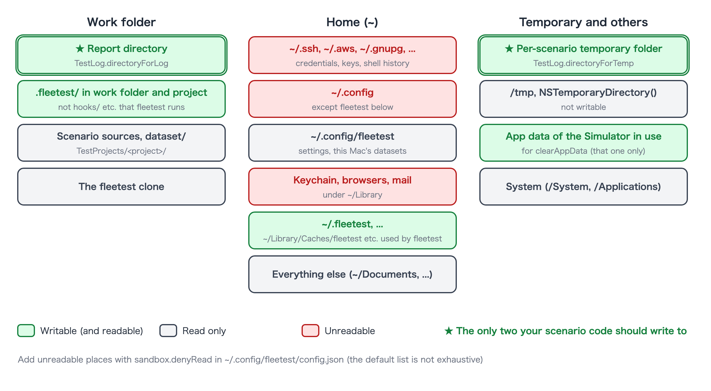
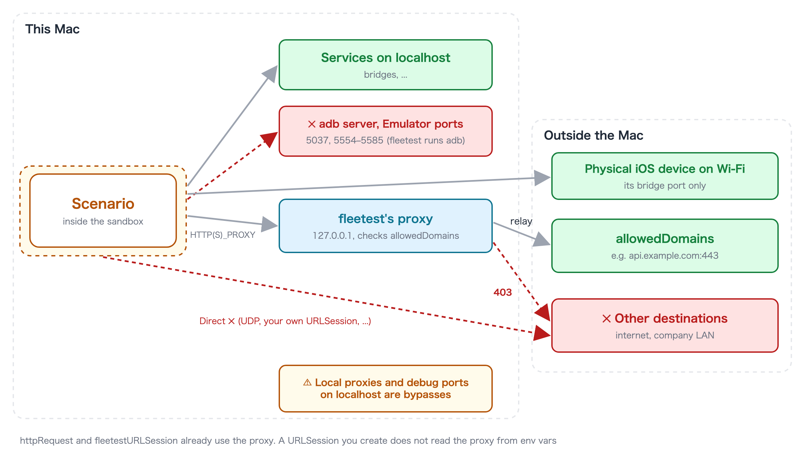

# Sandbox defaults (writable places, unreadable places, destinations)

[in Japanese(日本語)](sandbox_access_ja.md)

This page summarizes which folders a scenario inside the sandbox can read and write, and where it can connect.
For how the sandbox works, see [Checking the sandbox and opening the holes you need](../../security/sandbox.md).



## Writable folders

**When your scenario code writes files, use only these two.**

| Folder | Description |
|---|---|
| [`TestLog.directoryForLog`](../commands/test_log.md) | The output folder of this test class. Kept together with the report |
| [`TestLog.directoryForTemp`](../commands/test_log.md) | A temporary folder for this scenario only. Deleted when the scenario ends |

There are other places that are writable because fleetest itself uses them (they are not for your scenario code).

| Place | Used for |
|---|---|
| The report directory | Results, screenshots, logs |
| `.fleetest/` in the project and the work folder, `~/.fleetest/` | fleetest's state. Things fleetest itself reads and runs or distributes in the next run or when preparing devices (such as `hooks/`) are not writable |
| `~/Library/Logs/fleetest`, `~/Library/Caches/fleetest` | Logs, serializing Apple Intelligence calls |
| `~/Library/Caches/<scenario binary name>`, `~/Library/HTTPStorages/<scenario binary name>` | Model cache for image matching, the default store of `URLSession` |
| App data of the Simulator the scenario is using | So that `clearAppData` can delete data (other Simulators' data is not writable) |

**Examples of places you cannot write**: the scenario sources and other project files, the fleetest clone, the rest
of your home folder, `/tmp`, and the location returned by `NSTemporaryDirectory()` or
`FileManager.default.temporaryDirectory` (writing fails with "You don’t have permission").

## Readable folders

**Reading is allowed except for the list below** (the project, datasets, fleetest itself and so on are readable).
What is unreadable by default is the usual places for credentials and personal data.

| Kind | Unreadable places (relative to home) |
|---|---|
| Credentials and keys | `.ssh`, `.aws`, `.azure`, `.gnupg`, `.kube`, `.docker`, `.config` (but `config.json` and the running project's dataset under `.config/fleetest` are readable), `.netrc`, `.git-credentials`, `.npmrc`, `.pypirc`, `.pgpass`, `.vault-token`, `.terraform.d` |
| AI assistant settings | `.claude`, `.claude.json`, `.codex` |
| Build and distribution credentials | `.gradle`, `.m2`, `.gem/credentials`, `.cargo/credentials` (and `.toml`), `.pub-cache/credentials.json`, `.yarnrc`, `.yarnrc.yml`, `.bundle/config`, `.appstoreconnect`, `private_keys`, `.private_keys`, `.fastlane`, `.expo` |
| Android keys | `.android` (adb keys), `.emulator_console_auth_token` |
| Keychain and app data | `Library/Keychains`, `Library/Cookies`, `Library/Safari`, `Library/Mail`, `Library/Messages`, the profiles of Chrome, Firefox, Edge, Brave and Arc, app data of VSCode, Cursor, Slack and Claude |
| Shell history | `.zsh_history`, `.zsh_sessions`, `.bash_history`, `.bash_sessions`, `.python_history`, `.node_repl_history`, `.psql_history`, `.mysql_history` |

- **This list is not exhaustive.** If you keep secrets somewhere not listed, add it to `sandbox.denyRead` in the
  settings (it is **added** to the default list; it does not replace it).
- Under `~/.config/fleetest`, only `config.json` and the running project's dataset
  (`~/.config/fleetest/dataset/<project name>/`) are readable, so that `account()`, `data()` and `dataFile()` can read the values
  for this Mac only. Other projects' datasets cannot be read. None of them can be written.

## Environment variables

Only the environment variables fleetest uses are passed to scenarios (`PATH`, `HOME`, `USER`, `LANG`,
`DEVELOPER_DIR`, `JAVA_HOME`, `ANDROID_HOME` and so on, plus those starting with `FT_` / `LC_`). Tokens set in your
shell or in the `env` of `.mcp.json` are not visible, except that names starting with `FT_` are passed, so do not use
them for secrets. Put secrets a scenario needs in this Mac's file for
[`account()`](../commands/dataset.md).

## Destinations



| Destination | Reachable? |
|---|---|
| This Mac's localhost (bridges and so on) | Yes. Only the adb server (5037 by default), the Emulator ports (5554–5585) and Docker's API published on TCP (2375 / 2376) are closed |
| The bridge of a physical iOS device connected over Wi-Fi | Yes, through fleetest's relay on this Mac's `localhost` (the same shape as a USB tunnel). The relay exists only while that scenario runs and connects only to that device's bridge. No other host is reachable |
| Destinations listed in `sandbox.allowedDomains` | Yes, through fleetest's proxy |
| Anything else (the internet, the company LAN) | No |

To allow an external destination, write it in `~/.config/fleetest/config.json` on the Mac that runs the scenario.

```json
{
  "sandbox": {
    "allowedDomains": ["api.example.com:443", "*.example.org"]
  }
}
```

- `*.example.org` matches subdomains only; it does not include `example.org` itself.
- **A line without a port lets every port of that host through.** If you know the port, write it.
- Connections that do not go through the proxy cannot reach even allowed destinations. `httpRequest` and
  `fleetestURLSession` already use the proxy. A `URLSession` you create yourself does not read the proxy from
  environment variables, so it cannot connect as is.

The full syntax, how to connect and how to read failures are in
[Network access from scenarios](../writing/network_access.md).

## Settings file

All keys of the machine settings (`~/.config/fleetest/config.json`), including `sandbox.allowedDomains` and `sandbox.denyRead` on this page, are listed in [Machine settings (config.json)](../project/machine_settings.md).

### Link
- [index](../../index.md)
