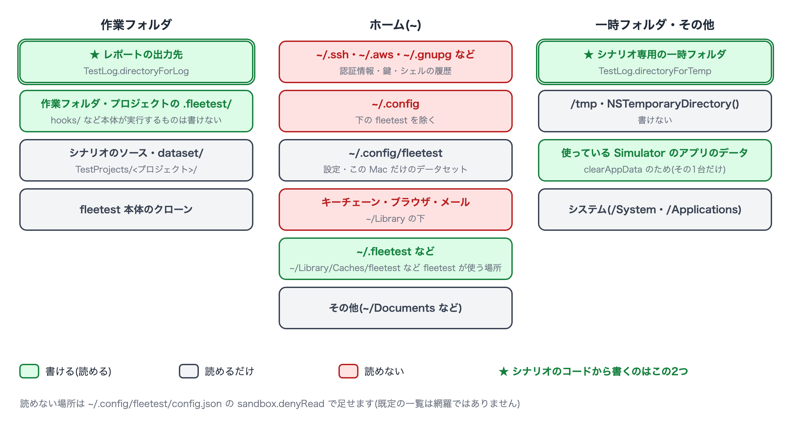
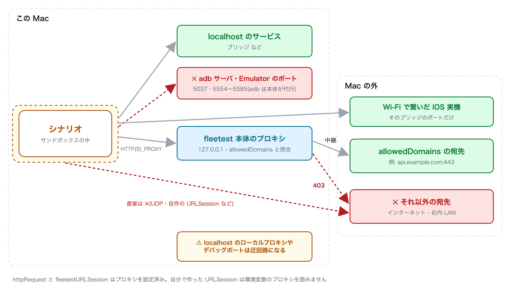

# サンドボックスの既定(書ける場所・読めない場所・通信先)

[in English](sandbox_access.md)

サンドボックスの中のシナリオが、どのフォルダを読み書きでき、どこへ通信できるかをまとめます。
仕組みは[サンドボックスを確かめて、必要な穴をあける](../../security/sandbox_ja.md)を見てください。



## 書けるフォルダ

**シナリオのコードから書くときは、次の2つだけを使ってください。**

| フォルダ | 説明 |
|---|---|
| [`TestLog.directoryForLog`](../commands/test_log_ja.md) | このテストクラスの出力フォルダ。レポートと一緒に残ります |
| [`TestLog.directoryForTemp`](../commands/test_log_ja.md) | このシナリオ専用の一時フォルダ。シナリオが終わると消えます |

このほかに、fleetest 自身が使うために書ける場所があります(シナリオのコードから使う場所ではありません)。

| 場所 | 用途 |
|---|---|
| レポートの出力先 | 結果・スクリーンショット・ログ |
| プロジェクトと作業フォルダの `.fleetest/`、`~/.fleetest/` | fleetest の状態の記録。ただし、次の run やデバイスの用意で fleetest 本体が読んで実行・配布するもの(`hooks/` など)は書けません |
| `~/Library/Logs/fleetest`・`~/Library/Caches/fleetest` | ログ、Apple Intelligence の呼び出しの直列化 |
| `~/Library/Caches/<シナリオ実行バイナリ名>`・`~/Library/HTTPStorages/<シナリオ実行バイナリ名>` | 画像照合のモデルのキャッシュ、`URLSession` の既定の保存先 |
| シナリオが使っている Simulator のアプリのデータ | `clearAppData` がデータを消すため(他の Simulator のものは書けません) |

**書けない場所の例**: シナリオのソースとプロジェクトの他のファイル、fleetest 本体のクローン、ホームの他の場所、
`/tmp`、`NSTemporaryDirectory()` や `FileManager.default.temporaryDirectory` が返す場所
(書くと「You don’t have permission」で失敗します)。

## 読めるフォルダ

**読み取りは、次の一覧を除いて許されています**(プロジェクト・データセット・fleetest 本体などは読めます)。
既定で読めないのは、認証情報と個人データの定番の置き場です。

| 種類 | 読めない場所(ホームからの相対) |
|---|---|
| 認証情報・鍵 | `.ssh`・`.aws`・`.azure`・`.gnupg`・`.kube`・`.docker`・`.config`(ただし `.config/fleetest` は読めます)・`.netrc`・`.git-credentials`・`.npmrc`・`.pypirc`・`.pgpass`・`.vault-token`・`.terraform.d` |
| AIアシスタントの設定 | `.claude`・`.claude.json`・`.codex` |
| ビルド・配布の資格情報 | `.gradle`・`.m2`・`.gem/credentials`・`.cargo/credentials`(`.toml` も)・`.pub-cache/credentials.json`・`.yarnrc`・`.yarnrc.yml`・`.bundle/config`・`.appstoreconnect`・`private_keys`・`.private_keys`・`.fastlane`・`.expo` |
| Android の鍵 | `.android`(adb の鍵)・`.emulator_console_auth_token` |
| キーチェーン・アプリのデータ | `Library/Keychains`・`Library/Cookies`・`Library/Safari`・`Library/Mail`・`Library/Messages`、Chrome・Firefox・Edge・Brave・Arc のプロファイル、VSCode・Cursor・Slack・Claude のアプリのデータ |
| シェルの履歴 | `.zsh_history`・`.zsh_sessions`・`.bash_history`・`.bash_sessions`・`.python_history`・`.node_repl_history`・`.psql_history`・`.mysql_history` |

- **この一覧は網羅ではありません**。ここに無い場所に秘密を置いているなら、設定の `sandbox.denyRead` に足してください
  (既定の一覧に**足す**形で、置き換えはしません)。
- `~/.config/fleetest` が読めるのは、`account()` / `data()` / `dataFile()` がこの Mac だけの値
  (`~/.config/fleetest/dataset/`)を読むためです。書くことはできません。

## 環境変数

シナリオに渡る環境変数は、fleetest が使うものだけです(`PATH`・`HOME`・`USER`・`LANG`・`DEVELOPER_DIR`・`JAVA_HOME`・
`ANDROID_HOME` などと、`FT_` / `LC_` で始まるもの)。シェルや `.mcp.json` の `env` に置いたトークンは見えません。
シナリオで使う秘密は [`account()`](../commands/dataset_ja.md) のこの Mac 側のファイルに置きます。

## 通信先



| 宛先 | 可否 |
|---|---|
| この Mac の localhost(ブリッジなど) | 繋がります。adb サーバ(既定 5037)と Emulator のポート(5554〜5585)だけは閉じています |
| Wi-Fi で繋いだ iOS 実機のブリッジ | そのブリッジのポート番号で繋がります。サンドボックスはポート番号でしか絞れないため、**同じ番号なら実機以外のどのホストにも繋がります**(プロキシと `allowedDomains` を通りません) |
| `sandbox.allowedDomains` に書いた宛先 | fleetest 本体のプロキシを経由して繋がります |
| それ以外(インターネット・社内 LAN) | 繋がりません |

外部の宛先を許可するには、シナリオを実行する Mac の `~/.config/fleetest/config.json` に書きます。

```json
{
  "sandbox": {
    "allowedDomains": ["api.example.com:443", "*.example.org"]
  }
}
```

- `*.example.org` はサブドメインだけに一致し、`example.org` そのものは含みません。
- **ポートを書かない行は、そのホストの全ポートを通します**。使うポートが決まっているなら書いてください。
- プロキシを通らない接続は、許可した宛先へも繋がりません。`httpRequest` と `fleetestURLSession` はプロキシを設定済みです。
  自分で作った `URLSession` は環境変数のプロキシを読まないので、そのままでは繋がりません。

書き方の全体・繋ぎ方・繋がらないときの見方は[シナリオから外部へ通信する](../writing/network_access_ja.md)にあります。

## 設定ファイル

このページの `sandbox.allowedDomains` / `sandbox.denyRead` など、マシン設定(`~/.config/fleetest/config.json`)の全キーは[マシン設定(config.json)](../project/machine_settings_ja.md)にまとめてあります。

### Link
- [index](../../index_ja.md)
