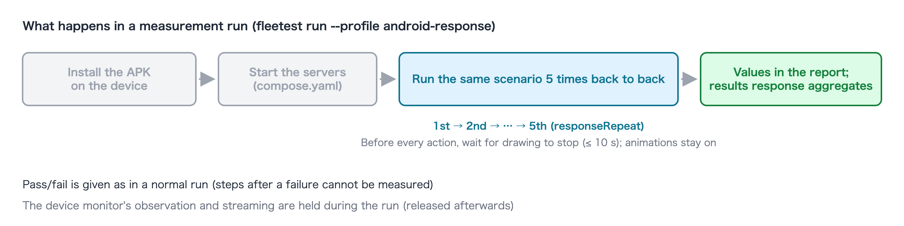

# Measuring app responsiveness

[in Japanese(日本語)](measuring_app_response_ja.md)

A follow-up to the [Quick start](../quick-start.md): the shortest path to experiencing response measurement by running the
sample app (SUT Store) on an **Android physical device**. It assumes you have finished the Quick start up to step 7
(creating one scenario for the login screen and running it).

Response measurement runs the scenarios you already have on a physical device and measures, for every action,
**how long the app takes to react** and **how long until the next action becomes possible**. The scenarios need no
change. The definition of the values, the whole setting and the list of reasons a value is missing are in the reference:
[Response measurement](../reference/running/response_measurement.md).

> Only **one Android or iOS physical device** can be measured (not the Simulator or the Emulator). This page uses Android,
> whose preparation is short. For iOS, see "Measuring on iOS" at the end.

## 1. Connect the device

Turn on USB debugging on the Android device, connect it to the Mac over USB and check that `adb devices` lists it as
`device`. Set the screen lock to none. For the details, see "Android" in [Adding physical devices](../fleet/adding_physical_devices.md).

```
List of devices attached
R5CT1234ABC    device
```

The left column is the device's identifier (serial). Step 4 uses it.

### Prompt for the AI

```text
Check that the Android physical device connected over USB shows up in adb as "device", and tell me its identifier (serial).
```

## 2. Write the Mac's LAN address in the machine settings

The sample app's servers (the services declared in compose.yaml) are normally published only inside the Mac (`127.0.0.1`).
A physical device has to reach them at the Mac's LAN address, so you write your consent to publishing on that address in
the machine settings. Without it, a run that includes a physical device does not start.

The machine settings (`~/.config/fleetest/config.json`) are **written by hand by the person who owns this Mac**. The AI
assistant cannot write them (with Claude Code, the setup adds a rule that refuses edits to this folder, because the
switch that loosens the sandbox lives there). Finding the address is something you can ask the AI.

### Prompt for the AI

```text
Tell me this Mac's LAN IPv4 address.
```

Then write it yourself in `~/.config/fleetest/config.json` (create the file if it does not exist).

```json
{ "services": { "publishForPhysicalDevices": "192.168.1.10" } }
```

<details>
<summary><b>If you do it manually (click to show details)</b></summary>

```bash
ipconfig getifaddr en0        # e.g. 192.168.1.10 (en0 for Wi-Fi, en1 or similar for wired)
```

</details>
<br>

The examples below use `192.168.1.10`. Replace it with your own address.

## 3. Build the app for the physical device

The sample app bakes the server's address into the build. The APK built in the Quick start is for the Emulator
(`10.0.2.2`), so from a physical device it cannot reach the server. Rebuild it with the Mac's LAN address as the
destination and keep it in a separate place from the Emulator build.

### Prompt for the AI

```text
Rebuild the sut-ec-mobile Android app with the server address set to 192.168.1.10 (-Psutec.server.host.android) and copy the resulting APK to ../sut-ec-mobile/build/android-physical/.
```

<details>
<summary><b>If you do it manually (click to show details)</b></summary>

Run in the sut-ec-mobile folder.

```bash
./gradlew :androidApp:assembleDebug -Psutec.server.host.android=192.168.1.10
mkdir -p build/android-physical
cp androidApp/build/outputs/apk/debug/androidApp-debug.apk build/android-physical/
```

</details>
<br>

When you use the Emulator APK again later, rebuild without `-P` (the copy for the physical device stays).

## 4. Make a run profile for measurement

Make a run profile `android-response` that uses the physical device and the APK built for it, and turn the measurement on.
Keep it separate from `android-run`, the profile for pass/fail tests: a measurement turns off recording and the text
visibility check, so a profile that has them turned on is refused. It also pins the run to one device.

### Prompt for the AI

```text
Create a fleetest run profile android-response that uses the Android physical device connected over USB. The app profile is android-physical-app, the APK is ../sut-ec-mobile/build/android-physical/androidApp-debug.apk, the app ID is com.sutec.mobile.android and the display name is "SUT Store". Write responseMeasurement: true and responseRepeat: 5 in the run profile.
```

<details>
<summary><b>If you do it manually (click to show details)</b></summary>

Run in the work folder (`--serial` is the identifier from step 1).

```bash
../foundation-tester/.build/debug/fleetest profile setup --platform android --app-id com.sutec.mobile.android \
  --app-name "SUT Store" --app-ref android-physical-app --run android-response \
  --serial R5CT1234ABC --device-name "Pixel 8" \
  --app-path ../sut-ec-mobile/build/android-physical/androidApp-debug.apk
```

Add `responseMeasurement` and `responseRepeat` to the resulting `TestProjects/project1/profiles/runs/android-response.json`.

```json
{
  "app": "android-physical-app",
  "devices": [
    { "platform": "android", "machine": "local", "name": "Pixel 8", "kind": "physical", "serial": "R5CT1234ABC" }
  ],
  "responseMeasurement": true,
  "responseRepeat": 5
}
```

</details>
<br>

`responseRepeat` is how many times the same scenario runs back to back (default 5, up to 50). More repeats give a steadier median.

## 5. Measure

### Prompt for the AI

```text
Run the login scenario created in the Quick start with the fleetest android-response profile.
```

<details>
<summary><b>If you do it manually (click to show details)</b></summary>

```bash
../foundation-tester/.build/debug/fleetest run --profile android-response --scenario <ClassName>
```

`<ClassName>` is the file name (without extension) of the scenario in `TestProjects/project1/scenarios/`.

</details>
<br>



This is what happens inside the run.

- The APK for the physical device is installed on the device and the servers are started (as in the Quick start run).
- The same scenario runs 5 times back to back. Before every action it waits for the app to stop drawing (up to
  10 seconds), so each run takes longer than usual.
- The device's animations **stay on** (a normal run turns them off), because the time users experience is what is measured.
- The device monitor's observation and streaming are held during the run. Tiles that stop updating are normal.
- Pass/fail is given as usual. In a scenario that failed, the steps after the failure cannot be measured.

## 6. Read the results

Each step in the scenario report (`TestProjects/project1/reports/`) gets its values.

```
- ✅ 3. tap "Log in" — 1.21s · first frame 213 ms · ready 283 ms
```

- `first frame` = **time to first frame** (from the tap until the app first redraws the screen)
- `ready` = **time until ready** (from the tap until the element the scenario operates next can be pressed)
- Verification steps such as `exist` get no values. The last action of a scenario has no `ready` (there is no next action).

Now look at the 5 runs together.

### Prompt for the AI

```text
List the fleetest response measurement results per step, with the median and the change from the previous run.
```

<details>
<summary><b>If you do it manually (click to show details)</b></summary>

```bash
../foundation-tester/.build/debug/fleetest results response
```

</details>
<br>

One row per step (example).

```
scenario     step                              device       host    n  median ms  p90 ms  busy  ready n  ready median ms  ready p90 ms  prev median ms  delta
-----------  --------------------------------  -----------  ------  -  ---------  ------  ----  -------  ---------------  ------------  --------------  -----
Login.S0010  s1 action tap tap "Log in" #1     R5CT1234ABC  my-mac  5  212        230     0     5        279              301           -               -
Login.S0010  s2 action tap tap "My page" #1    R5CT1234ABC  my-mac  5  177        190     0     5        10               15            -               -
Login.S0010  s2 action tap tap "Settings" #1   R5CT1234ABC  my-mac  5  91         98      0     0        -                -             -               -
```

| Column | How to read it |
|---|---|
| `median ms` / `p90 ms` | Median and p90 of the time to first frame. `n` is the sample count (the number of runs) |
| `ready median ms` | Median of the time until ready. A row whose next element stays in the same place throughout the transition (a tab bar, …) reads a few milliseconds. It means "pressable from the start of the transition" and is not an anomaly |
| `busy` | How many times the app was still drawing before the action, so that run was not measured. A high count means the previous action's animation does not stop within 10 seconds on that screen |
| `prev median ms` / `delta` | The change from the previous measurement run. `-` on the first run |

## 7. Measure again and look at the change

Run the same profile once more, and `prev median ms` and `delta` are filled in.

```text
Run the same scenario again with the fleetest android-response profile and list the change from the previous run.
```

```
... prev median ms  delta
... 212             +4 (+2%)
... 177             -3 (-2%)
```

- Only runs on **the same Mac and the same device** are compared.
- `delta` is listed as a fact; it never fails a test. Deciding that the app got slower is up to you.
- **A difference based on few samples cannot be told apart from noise.** When a difference matters, raise `responseRepeat`
  (`--set responseRepeat=10` overrides it for that run only).
- To measure after changing the app, rebuild the APK into the same place as in step 3 and run again.

## Measuring on iOS

- Finish the "iOS" steps in [Adding physical devices](../fleet/adding_physical_devices.md) (signing, `appPathPhysical`) and make a profile
  that uses the iOS physical device in step 4. For the sample app's iOS destination, build with the environment variable
  `SUTEC_SERVER_HOST_IOS` set to the Mac's LAN address.
- The time to first frame is recorded with Xcode Instruments, so the device must be in a state Instruments can record.
- On iOS, the time until ready never reads shorter than **about 0.7 seconds**, because reading the screen's element information
  takes a few hundred milliseconds each time. Do not compare it directly with Android's few milliseconds.

## Next

- **Measure your own app**: add a physical device ([Adding physical devices](../fleet/adding_physical_devices.md)), point the app at a
  destination the device can reach ("④ Point the app at the server" in [Preparing the servers your app depends on](../tutorial/preparing_app_server.md)),
  then do steps 4 to 7 the same way.
- **Measure regularly**: since only the same Mac and device are compared, pick one runner machine with the physical device
  connected and dispatch to it with `--runner` ([Remote Runners](../fleet/remote_runners.md)).
- **Specification**: [Response measurement](../reference/running/response_measurement.md), [Run profile](../reference/project/run_profile.md)

### Link
- [index](../index.md)
