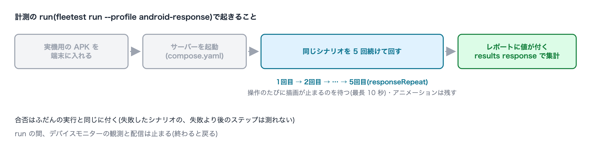

# アプリの反応の速さを測る

[in English](measuring_app_response.md)

[クイックスタート](../quick-start_ja.md)の続きとして、サンプルアプリ(SUT Store)を **Android の実機**で動かし、
レスポンス計測を体験する最短手順です。クイックスタートのステップ 7 まで(ログイン画面のシナリオを1本作って
実行する)を終えていることが前提です。

レスポンス計測は、作ったシナリオをそのまま実機で回しながら、操作ごとに**アプリが反応するまで**と**次の操作が
できるようになるまで**の時間を測る機能です。シナリオの書き換えは要りません。測る値の定義・設定の全体・
値が出ない理由の一覧は、リファレンスの[レスポンス計測](../reference/running/response_measurement_ja.md)にあります。

> 計測できるのは **Android か iOS の実機 1 台**だけです(Simulator・Emulator は対象外)。このページは準備が短い
> Android で進めます。iOS は末尾の「iOS で測るとき」を見てください。

## 1. 実機をつなぐ

Android の端末で USB デバッグを ON にし、USB で Mac につないで、`adb devices` に `device` と出ることを確かめます。
画面ロックは「なし」にします。手順の詳細は[実機を追加する](../fleet/adding_physical_devices_ja.md)の「Android」。

```
List of devices attached
R5CT1234ABC    device
```

左の列が端末の識別子(serial)です。ステップ 4 で使います。

### AIへの指示文

```text
USB でつないだ Android の実機が adb に device として見えているか確かめて、識別子(serial)を教えて。
```

## 2. Mac の LAN アドレスをマシン設定に書く

サンプルアプリのサーバー(compose.yaml で宣言したサービス)は、ふだんは Mac の中(`127.0.0.1`)だけに公開されます。
実機からは Mac の LAN アドレスで届く必要があるので、そのアドレスへ公開することへの同意をマシン設定に書きます。
書いていないと、実機を含む run は始まりません。

マシン設定(`~/.config/fleetest/config.json`)は、**この Mac の人が手で書きます**。AIアシスタントは書けません
(Claude Code では、導入時にこのフォルダの編集を拒否する設定が入ります。サンドボックスを緩める口がここにあるためです)。
アドレスを調べるところまでは AI に頼めます。

### AIへの指示文

```text
この Mac の LAN の IPv4 アドレスを教えて。
```

次に、`~/.config/fleetest/config.json`(無ければ作ります)に自分で書きます。

```json
{ "services": { "publishForPhysicalDevices": "192.168.1.10" } }
```

<details>
<summary><b>手動で実行する場合(クリックで詳細表示)</b></summary>

```bash
ipconfig getifaddr en0        # 例: 192.168.1.10(Wi-Fi は en0、有線は en1 など)
```

</details>
<br>

以降の例では `192.168.1.10` と書きます。自分のアドレスに読み替えてください。

## 3. 実機用のアプリをビルドする

サンプルアプリは、サーバーの接続先をビルドに焼き込みます。クイックスタートで作った APK は Emulator 向け
(`10.0.2.2`)なので、実機からはサーバーに届きません。接続先を Mac の LAN アドレスにしてビルドし直し、
Emulator 用とは別の場所に置きます。

### AIへの指示文

```text
sut-ec-mobile の Android アプリを、接続先サーバーを 192.168.1.10 にして(-Psutec.server.host.android)ビルドし直し、できた APK を ../sut-ec-mobile/build/android-physical/ にコピーして。
```

<details>
<summary><b>手動で実行する場合(クリックで詳細表示)</b></summary>

sut-ec-mobile のフォルダで実行します。

```bash
./gradlew :androidApp:assembleDebug -Psutec.server.host.android=192.168.1.10
mkdir -p build/android-physical
cp androidApp/build/outputs/apk/debug/androidApp-debug.apk build/android-physical/
```

</details>
<br>

Emulator 用の APK をあとでまた使うときは、`-P` を付けずにビルドし直します(実機用のコピーは残ります)。

## 4. 計測用の実行プロファイルを作る

実機と実機用の APK を使う実行プロファイル `android-response` を作り、計測を有効にします。
合否のテストに使う `android-run` とは分けます —— 計測では録画やテキストの可視性検証を止めるので、
それらを有効にしたプロファイルでは run を断られます。デバイスも1台に固定します。

### AIへの指示文

```text
fleetest に、USB でつないでいる Android の実機を使う実行プロファイル android-response を作って。アプリプロファイルは android-physical-app で、APK は ../sut-ec-mobile/build/android-physical/androidApp-debug.apk、アプリ ID は com.sutec.mobile.android、表示名は「SUT Store」。実行プロファイルに responseMeasurement: true と responseRepeat: 5 を書いて。
```

<details>
<summary><b>手動で実行する場合(クリックで詳細表示)</b></summary>

作業フォルダで実行します(`--serial` はステップ 1 の識別子)。

```bash
../foundation-tester/.build/debug/fleetest profile setup --platform android --app-id com.sutec.mobile.android \
  --app-name "SUT Store" --app-ref android-physical-app --run android-response \
  --serial R5CT1234ABC --device-name "Pixel 8" \
  --app-path ../sut-ec-mobile/build/android-physical/androidApp-debug.apk
```

できた `TestProjects/project1/profiles/runs/android-response.json` に、`responseMeasurement` と `responseRepeat` を足します。

```json
{
  "app": "android-physical-app",
  "devices": [
    { "platform": "android", "machine": "local", "name": "Pixel 8", "kind": "physical", "serial": "R5CT1234ABC" }
  ],
  "responseMeasurement": true,
  "responseRepeat": 5
}
```

</details>
<br>

`responseRepeat` は、同じシナリオを続けて回す回数です(既定 5・最大 50)。回数が多いほど中央値が安定します。

## 5. 計測する

### AIへの指示文

```text
fleetest の android-response プロファイルで、クイックスタートで作ったログインのシナリオを実行して。
```

<details>
<summary><b>手動で実行する場合(クリックで詳細表示)</b></summary>

```bash
../foundation-tester/.build/debug/fleetest run --profile android-response --scenario <クラス名>
```

`<クラス名>` は、`TestProjects/project1/scenarios/` にあるシナリオのファイル名(拡張子なし)です。

</details>
<br>



run の中では次のことが起きます。

- 実機用の APK を端末に入れ、サーバーを起動します(クイックスタートの実行と同じ)。
- 同じシナリオを 5 回続けて回します。操作のたびにアプリの描画が止まるのを待ってから操作する(最長 10 秒)ので、
  1回ずつはふだんより長くかかります。
- 端末のアニメーションは**残します**(ふだんの実行では止めます)。利用者が感じる時間を測るためです。
- run の間、デバイスモニターの観測と配信は止まります。タイルが更新されなくても正常です。
- 合否はふだんと同じに付きます。失敗したシナリオの、失敗より後のステップは測れません。

## 6. 結果を見る

シナリオのレポート(`TestProjects/project1/reports/`)の各ステップに、値が付きます。

```
- ✅ 3. tap "ログイン" — 1.21s · first frame 213 ms · ready 283 ms
```

- `first frame` = **最初のフレームまで**(タップしてから、アプリが最初に画面を描き直すまで)
- `ready` = **操作可能まで**(タップしてから、シナリオが次に操作する要素が押せるようになるまで)
- `exist` などの検証のステップには付きません。シナリオの最後の操作には `ready` がありません(次の操作が無いため)。

5 回分をまとめて見ます。

### AIへの指示文

```text
fleetest のレスポンス計測の結果を、ステップごとに中央値と前回との差で一覧にして。
```

<details>
<summary><b>手動で実行する場合(クリックで詳細表示)</b></summary>

```bash
../foundation-tester/.build/debug/fleetest results response
```

</details>
<br>

ステップごとに1行で並びます(例)。

```
scenario       step                               device       host    n  median ms  p90 ms  busy  ready n  ready median ms  ready p90 ms  prev median ms  delta
-------------  ---------------------------------  -----------  ------  -  ---------  ------  ----  -------  ---------------  ------------  --------------  -----
ログイン.S0010  s1 action tap tap "ログイン" #1     R5CT1234ABC  my-mac  5  212        230     0     5        279              301           -               -
ログイン.S0010  s2 action tap tap "マイページ" #1   R5CT1234ABC  my-mac  5  177        190     0     5        10               15            -               -
ログイン.S0010  s2 action tap tap "設定" #1         R5CT1234ABC  my-mac  5  91         98      0     0        -                -             -               -
```

| 列 | 見方 |
|---|---|
| `median ms` / `p90 ms` | 最初のフレームまでの中央値と p90。`n` は標本数(回した回数) |
| `ready median ms` | 操作可能までの中央値。遷移の間もずっと同じ位置にある部品(タブバーなど)を次に押す行は数 ms になります。「遷移の最初から押せる」という意味で、異常ではありません |
| `busy` | 操作の前から描画が続いていて、その回は測らなかった回数。多いなら、その画面は前の操作のアニメーションが 10 秒止まりません |
| `prev median ms` / `delta` | 前回の計測 run との差。初回は `-` です |

## 7. もう1度測って、差を見る

同じプロファイルでもう1度回すと、`prev median ms` と `delta` が埋まります。

```text
fleetest の android-response プロファイルで同じシナリオをもう1度実行して、前回との差を一覧にして。
```

```
... prev median ms  delta
... 212             +4 (+2%)
... 177             -3 (-2%)
```

- 比べるのは、**同じ Mac・同じ端末**の run どうしだけです。
- `delta` は事実として並ぶだけで、合否は付けません。遅くなったと判断するのは人です。
- **標本が少ない差は、ばらつきと区別できません。** 差が気になるときは `responseRepeat` を増やします
  (`--set responseRepeat=10` で、その run だけ上書きできます)。
- アプリを変えたあとに測るときは、ステップ 3 と同じ場所に APK をビルドし直してから回します。

## iOS で測るとき

- [実機を追加する](../fleet/adding_physical_devices_ja.md)の「iOS」の手順(署名・`appPathPhysical`)を済ませ、ステップ 4 で iOS の実機を
  使うプロファイルを作ります。サンプルアプリの iOS の接続先は、環境変数 `SUTEC_SERVER_HOST_IOS` に Mac の LAN アドレスを入れてビルドします。
- 「最初のフレームまで」は Xcode の Instruments で記録するので、その端末を Instruments で記録できる状態が要ります。
- iOS の「操作可能まで」は、画面の要素を1回読むのに数百 ms かかるため、**約 0.7 秒より短くは出ません**。Android の数 ms と直接比べないでください。

## 次へ

- **自分のアプリで測る**: 実機を追加し([実機を追加する](../fleet/adding_physical_devices_ja.md))、アプリの接続先を実機から届く宛先にして
  ([アプリが依存するサーバーを用意する](../own_app/preparing_server_ja.md)の「アプリの接続先を合わせる」)、ステップ 4〜7 を同じように行います。
- **定期的に測る**: 比べられるのは同じ Mac・同じ端末だけなので、実機をつないだランナー機を1台決めて `--runner` で飛ばします([リモート実行](../fleet/remote_runners_ja.md))。
- **仕様**: [レスポンス計測](../reference/running/response_measurement_ja.md)・[実行プロファイルの設定項目](../reference/project/run_profile_ja.md)

### Link
- [index](../index_ja.md)
