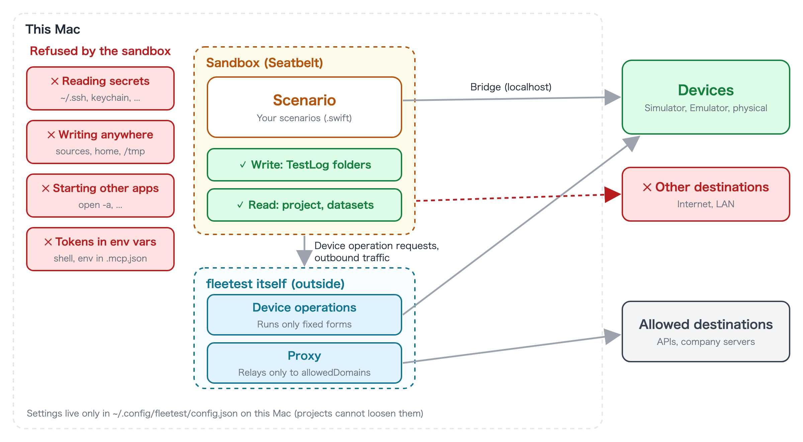

# Checking the sandbox and opening the holes you need

[in Japanese(日本語)](sandbox_ja.md)

A follow-up to the [Quick start](../quick-start.md): you see what the sandbox around scenarios stops, then open only
what you need. It assumes you have finished the Quick start (there is one scenario for the sample app SUT Store and you
can run it on a device).

fleetest **always runs scenarios (`.swift`) inside the macOS sandbox (Seatbelt)**. Scenarios are often written by an AI
assistant, and you may run scenarios received from others, so wrong or malicious code could read this Mac's secrets and
send them out. The OS refuses what is not allowed, whatever the scenario's code says.

| What it protects | What a scenario cannot do |
|---|---|
| This Mac's secrets | Read the usual places for credentials, such as `~/.ssh`, the keychain and browser profiles |
| This Mac's files | Write anywhere but the report output folder and the temporary folder |
| Outbound traffic | Talk to a destination that is not allowed |
| Other programs | Start other apps, or drive Simulators and Android devices other than in fixed ways |
| The launching environment | Read environment variables such as tokens put in the shell or `.mcp.json` |



Device operations (`tap`, `installApp` and so on) and outbound traffic are done or relayed by fleetest itself, outside
the frame. How you write the DSL does not change.

## 1. See where it stops

You write a scenario that checks the stops, and run it. Three things fail here (the failures are the correct result).

1. Writing a file somewhere else in the home folder (`~/Desktop`)
2. Reading `~/.ssh`
3. Going out with `httpRequest` (`https://example.com`)

### Prompt for the AI

```text
Create a scenario that checks what the sandbox stops, in a class named SandboxCheck. Make three @Test methods:
S0010 writes ~/Desktop/fleetest-sandbox-check.txt, S0020 reads the contents of ~/.ssh, and S0030 fetches https://example.com with httpRequest and checks that the status is 200.
Write each inside a procedure and throw errors as they are. Then run it on iOS and show me the three failure messages.
```

On a Mac without `~/.ssh`, you cannot tell "unreadable" from "not there". Check with `ls -d ~/.ssh` first.

<details>
<summary><b>If you do it manually (click to show details)</b></summary>

Create `TestProjects/project1/scenarios/SandboxCheck.swift`.

```swift
import FTDSL
import Foundation

@TestClass
class SandboxCheck {

    @Test("Write somewhere else in the home folder")
    func S0010() {
        scenario {
            scene(1, "Write to the Desktop") {
                action {
                    procedure("Write to ~/Desktop") {
                        let path = NSHomeDirectory() + "/Desktop/fleetest-sandbox-check.txt"
                        try "x".write(toFile: path, atomically: true, encoding: .utf8)
                    }
                }
            }
        }
    }

    @Test("Read ~/.ssh")
    func S0020() {
        scenario {
            scene(1, "Read a credentials place") {
                action {
                    procedure("Read ~/.ssh") {
                        _ = try FileManager.default.contentsOfDirectory(atPath: NSHomeDirectory() + "/.ssh")
                    }
                }
            }
        }
    }

    @Test("Talk to the outside")
    func S0030() {
        scenario {
            scene(1, "Fetch example.com") {
                action {
                    let response = httpRequest("https://example.com")
                    response.status.thisIs(200)
                }
            }
        }
    }
}
```

Run it (`--profile` is the run profile prepared in step 5 of the Quick start).

```bash
../foundation-tester/.build/debug/fleetest run --profile ios-run --scenario SandboxCheck
```

To run just one, pass `class.method`, such as `--scenario SandboxCheck.S0030`.

</details>
<br>

Running it makes all three **fail** (that is the expected result). The report (`TestProjects/project1/reports/`) shows these failure messages.

- S0010: `You don’t have permission to save the file “fleetest-sandbox-check.txt” in the folder “Desktop”.` (it cannot write)
- S0020: `The folder “.ssh” doesn’t exist.` (an unreadable place **looks as if it did not exist**: it is on the Mac, but invisible from inside the frame)
- S0030: `A server with the specified hostname could not be found. (NSURLErrorDomain -1003)` (without `allowedDomains` no outbound
  route (the proxy) is set up, so even name resolution fails. When `allowedDomains` lists other hosts only, the proxy refuses the
  connection, the request fails with `kCFErrorDomainCFNetwork error 310`, and the message adds a note that the connection goes through
  the sandbox proxy and that hosts not in `allowedDomains` are refused)

When failures pile up on the same device, the run's check for a broken device kicks in and prints the warning
`3 consecutive failures on this lane … keeping the lane` (only when some scenario passed on another device meanwhile does it
restart the worker and run the last one again; that adds some ten seconds and does not change the result). A test that only has a
`procedure` also gets a "no assertions" warning; here that is intended.

The list of places that cannot be written, read or reached is in [Sandbox defaults](../reference/running/sandbox_access.md).

## 2. Open outbound traffic

Only the destinations you write in `~/.config/fleetest/config.json` on the Mac that runs the scenarios are opened.
**A person on this Mac writes this file by hand** (step 8). Write the following (create the file if it does not exist).

```json
{
  "sandbox": {
    "allowedDomains": ["example.com:443"]
  }
}
```

You write the port because, without it, every port of the host (including other services such as databases) is
reachable. The setting takes effect from the next scenario launch, so run the same scenario as in step 1 again.

### Prompt for the AI

```text
Run only S0030 of SandboxCheck on iOS and show me the result.
```

<details>
<summary><b>If you do it manually (click to show details)</b></summary>

```bash
../foundation-tester/.build/debug/fleetest run --profile ios-run --scenario SandboxCheck.S0030
```

</details>
<br>

Running it again makes S0030 **pass** (S0010 and S0020 are still refused).
How to write `allowedDomains` (such as the `*.example.org` wildcard) and how to read a failed connection are in
[Network access from scenarios](../reference/writing/network_access.md).

## 3. Where to write

When you want to write files, use the fixed doors instead of opening a hole. `TestLog.directoryForLog` (kept with the
report) and `TestLog.directoryForTemp` (deleted when the scenario ends) are writable.

### Prompt for the AI

```text
Add S0040 to SandboxCheck. Write note.txt to TestLog.directoryForLog and work.txt to TestLog.directoryForTemp, nothing else. Run S0040 on iOS and tell me where note.txt ended up.
```

<details>
<summary><b>If you do it manually (click to show details)</b></summary>

Add this to the `SandboxCheck` class.

```swift
    @Test("Write to the TestLog folders")
    func S0040() {
        scenario {
            scene(1, "Write to the fixed doors") {
                action {
                    procedure("Write to the TestLog folders") {
                        let note = TestLog.directoryForLog.appendingPathComponent("note.txt")
                        try "ok".write(to: note, atomically: true, encoding: .utf8)
                        let work = TestLog.directoryForTemp.appendingPathComponent("work.txt")
                        try "ok".write(to: work, atomically: true, encoding: .utf8)
                    }
                }
            }
        }
    }
```

```bash
../foundation-tester/.build/debug/fleetest run --profile ios-run --scenario SandboxCheck.S0040
```

</details>
<br>

Running it makes S0040 pass, and `note.txt` stays under the class name in that run's output folder (`work.txt` is deleted
when the scenario ends). Details: [Output folder and temporary folder (TestLog)](../reference/commands/test_log.md).

Only when the scripts that run before and after a run (`run-setup.sh` / `run-teardown.sh`) have to write somewhere
other than `<workspace>/data/`, add the place to `hooks.writablePaths` in the machine settings.

```json
{
  "hooks": {
    "writablePaths": ["~/work/shared-fixtures"]
  }
}
```

How to write the scripts is in "Running scripts before and after a run" of [Adding your own features](../reference/writing/extending.md).

## 4. How to pass secrets

Shell environment variables (tokens and so on) are not visible to scenarios. Put the secrets a scenario uses in the
dataset file that exists only on this Mac
(`~/.config/fleetest/dataset/<project name>/accounts.json`; the project name is the project's folder name) and read
them with `account()`. **A person on this Mac creates the file by hand** (step 8).

```json
{
  "[demo]": { "token": "dummy-token-1234" }
}
```

### Prompt for the AI

```text
Add S0050 to SandboxCheck. Check that the environment variable DEMO_TOKEN looks empty to the scenario (thisIsEmpty) and that account("[demo].token") is not empty (thisIsNotEmpty).
Run S0050 on iOS with fleetest run, with DEMO_TOKEN=dummy in front, and show me the result. Do not print the values themselves.
```

<details>
<summary><b>If you do it manually (click to show details)</b></summary>

Add this to the `SandboxCheck` class.

```swift
    @Test("The environment variable is hidden and account() works")
    func S0050() {
        scenario {
            scene(1, "How to pass secrets") {
                action {
                    (ProcessInfo.processInfo.environment["DEMO_TOKEN"] ?? "").thisIsEmpty()
                    account("[demo].token").thisIsNotEmpty()
                }
            }
        }
    }
```

```bash
DEMO_TOKEN=dummy ../foundation-tester/.build/debug/fleetest run --profile ios-run --scenario SandboxCheck.S0050
```

</details>
<br>

If you run it before placing the dataset file, the `account()` step fails and the message lists every path it looked at
(not the values). After you place the file and run again, it passes. The variable looking empty is the sandbox at work.
Whether the `account()` value stays in the report is something you check in
[Checking what a test leaves behind](test_outputs.md).
Where the files go and their format are in [Test data and accounts (account, data, dataFile, addMedia)](../reference/commands/dataset.md).

## 5. Use adb directly

If a scenario calls `adb` directly, it is refused by default (device operations go through fleetest itself through the
DSL commands, so you normally do not need it). Only when you really need it, set `sandbox.allowDirectAdb` to `true` in
the machine settings.

```json
{
  "sandbox": {
    "allowDirectAdb": true
  }
}
```

**Once it is open, a scenario can reach the outside through the shell inside an Emulator and reach every connected
Android device.** After you have checked, set it back to `false`. The Android SDK (adb) must be installed.

### Prompt for the AI

```text
Add S0060 to SandboxCheck. Run adb devices with Process and check that the output contains "List of devices attached".
Run S0060 on iOS and show me the result.
```

<details>
<summary><b>If you do it manually (click to show details)</b></summary>

Add this to the `SandboxCheck` class.

```swift
    @Test("Call adb from a scenario")
    func S0060() {
        scenario {
            scene(1, "adb devices") {
                action {
                    procedure("Run adb devices") {
                        let process = Process()
                        process.executableURL = URL(fileURLWithPath: "/usr/bin/env")
                        process.arguments = ["adb", "devices"]
                        let pipe = Pipe()
                        process.standardOutput = pipe
                        try process.run()
                        let data = pipe.fileHandleForReading.readDataToEndOfFile()
                        process.waitUntilExit()
                        let output = String(data: data, encoding: .utf8) ?? ""
                        guard output.contains("List of devices attached") else {
                            throw NSError(domain: "demo", code: 1,
                                          userInfo: [NSLocalizedDescriptionKey: "adb is not usable: \(output)"])
                        }
                    }
                }
            }
        }
    }
```

```bash
../foundation-tester/.build/debug/fleetest run --profile ios-run --scenario SandboxCheck.S0060
```

</details>
<br>

While `allowDirectAdb` is `false`, adb starts but cannot reach the adb server (port 5037), and S0060 fails with
`adb: failed to check server version: cannot connect to daemon` (the sandbox closes that port). Once it is `true`, S0060 passes. After you have checked, set it
back to `false`.

## 6. Add places that cannot be read (the other direction)

The default list of unreadable places is the usual places for credentials and is not exhaustive. If a secret is
somewhere that is not in the list, add it to `sandbox.denyRead` (it **adds** to the default list; it does not replace it).

Here you create a folder that stands for where you keep a secret, and watch it become unreadable.

### Prompt for the AI

```text
Create ~/fleetest-demo-secrets/note.txt with the contents hello.
Add S0070 to SandboxCheck that only reads that file (try inside a procedure). Run S0070 on iOS and show me the result.
```

<details>
<summary><b>If you do it manually (click to show details)</b></summary>

```bash
mkdir -p ~/fleetest-demo-secrets && echo hello > ~/fleetest-demo-secrets/note.txt
```

Add this to the `SandboxCheck` class.

```swift
    @Test("Read the added secret place")
    func S0070() {
        scenario {
            scene(1, "Read the demo folder") {
                action {
                    procedure("Read ~/fleetest-demo-secrets/note.txt") {
                        _ = try String(contentsOfFile: NSHomeDirectory() + "/fleetest-demo-secrets/note.txt", encoding: .utf8)
                    }
                }
            }
        }
    }
```

```bash
../foundation-tester/.build/debug/fleetest run --profile ios-run --scenario SandboxCheck.S0070
```

</details>
<br>

It is not in the list yet, so S0070 **passes** (it can read the file). Add the following to the machine settings and run
again.

```json
{
  "sandbox": {
    "denyRead": ["~/fleetest-demo-secrets"]
  }
}
```

Running it again makes S0070 **fail** with `The file “note.txt” couldn’t be opened because you don’t have permission to view it.`. After you have checked, remove the `denyRead`
line and `~/fleetest-demo-secrets`.

## 7. Take everything off (only to isolate a cause)

Only when you want to tell whether a scenario fails with a permission error because of the sandbox or something else,
you can take the whole sandbox off.

```json
{
  "sandbox": {
    "disabled": true
  }
}
```

Run S0010 from step 1 again, and this time it can write and **passes** (`~/Desktop/fleetest-sandbox-check.txt` is created).

### Prompt for the AI

```text
Run only S0010 of SandboxCheck on iOS and show me the result.
```

<details>
<summary><b>If you do it manually (click to show details)</b></summary>

```bash
../foundation-tester/.build/debug/fleetest run --profile ios-run --scenario SandboxCheck.S0010
rm ~/Desktop/fleetest-sandbox-check.txt
```

</details>
<br>

After you have checked, **always set `disabled` back to `false` (or delete the line)** and delete the file it created.
If it works with the sandbox off, the scenario does something the sandbox refuses. Do not leave it off; rewrite it with
the fixed doors in steps 3 and 4.

## 8. Who can open holes

You have written every setting so far in `~/.config/fleetest/config.json` on the Mac that runs the scenarios.
**That file is the only place that can loosen the sandbox.** The project, run profiles and environment variables cannot,
because the project is a place an AI assistant can rewrite, and a switch there would make the sandbox pointless.
Scenarios themselves cannot rewrite this file either. When you run on another Mac (a remote runner), that Mac's
settings are used.

With Claude Code, setup writes a deny rule `Edit(~/.config/fleetest/**)` into the work folder's `.claude/settings.json`,
so the AI assistant cannot edit this folder. Try it.

### Prompt for the AI

```text
Add example.org:443 to sandbox.allowedDomains in ~/.config/fleetest/config.json.
```

The AI assistant is refused the edit and can only tell you what to write. A person on this Mac does the
writing by hand.

The rule is written when the fleetest clone is **outside** the work folder, such as next to it (the Quick start layout).
It is not written when the work folder is inside the clone.

## Good to know

- There are things the sandbox **does not stop** (operations on the app under test, services on this Mac's localhost
  and so on). The points for judging are in [Notes and limitations](limitations.md).
- It is always on. Whether you run with `fleetest run`, a dry-run, MCP, the VSCode extension or a remote runner, the
  scenario runs inside the frame.
- Only the scenario binary and its descendants go into the sandbox. fleetest itself, the app under test, evaluating
  `Package.swift` and building dependencies run outside. `services.buildSources`, which widens the places a compose.yaml
  `build:` may refer to, is in [Services the app depends on (compose.yaml)](../reference/writing/services.md).
- It adds only some ten milliseconds per launch, which barely shows in the total test time.
- The list of setting keys is in [Machine settings (config.json)](../reference/project/machine_settings.md), and the
  default writable places, unreadable places and destinations are in
  [Sandbox defaults](../reference/running/sandbox_access.md).
- Features that make it easy to write inside the frame, such as using external Swift packages or passing values between
  scenarios, are in [Helpful features for writing test code](../reference/writing/helpers.md).

## Next

- **See what a test leaves behind**: [Checking what a test leaves behind](test_outputs.md)
- **Know what is not stopped**: [Notes and limitations](limitations.md)
- **Know the network exposure**: [Network Exposure and Security](network_security.md)

### Link
- [index](../index.md)
