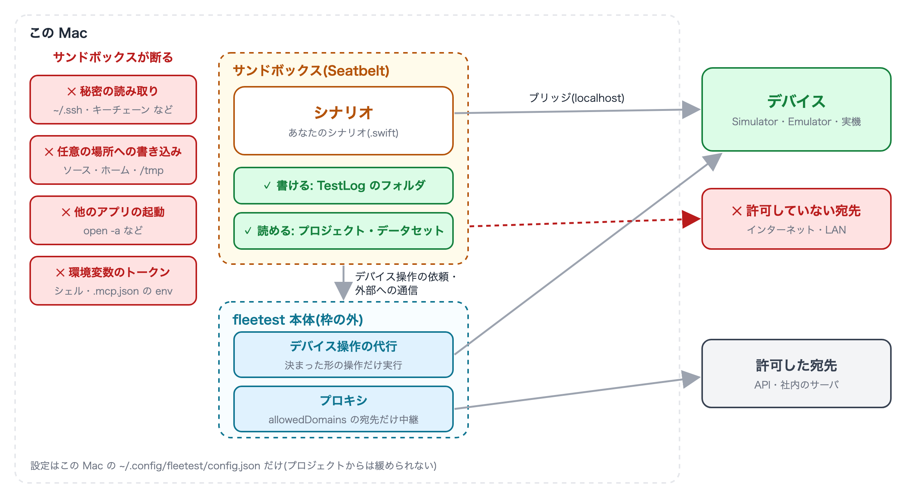

# サンドボックスを確かめて、必要な穴をあける

[in English](sandbox.md)

[クイックスタート](../quick-start_ja.md)の続きとして、シナリオを囲むサンドボックスが何を止めるかを実際に見て、
必要なものだけを開ける手順です。クイックスタートを終えていること(サンプルアプリ SUT Store のシナリオが1本あり、
デバイスで実行できること)が前提です。

fleetest は、シナリオ(`.swift`)を**常に macOS のサンドボックス(Seatbelt)の中で実行します**。シナリオを書くのは
AIアシスタントのことが多く、他人から受け取ったシナリオを動かすこともあるので、誤ったコードや悪意のあるコードが
この Mac の秘密を読んで外へ送ることを、シナリオのコードに何が書かれていても OS が断る形にしています。

| 守るもの | シナリオができないこと |
|---|---|
| この Mac の秘密 | `~/.ssh`・キーチェーン・ブラウザのプロファイルなど、認証情報の定番の置き場を読む |
| この Mac のファイル | レポートの出力先・一時フォルダ・fleetest の状態の記録(`.fleetest/` など)以外に書く |
| 外部への送信 | 許可していない宛先へ通信する |
| 他のプログラム | 他のアプリを起こす・Simulator や Android 端末を決まった操作以外で動かす |
| 起動した環境 | シェルや `.mcp.json` に置いたトークンなどの環境変数を読む |



デバイスの操作(`tap` や `installApp` など)と外部への通信は、枠の外の fleetest 本体が代行・中継します。
DSL の書き方は何も変わりません。

## 1. 止まるところを見る

止められることを確かめるシナリオを書いて実行します。ここでは次の3つが失敗します(失敗が正しい結果です)。

1. ホームの別の場所(`~/Desktop`)へファイルを書く
2. `~/.ssh` を読む
3. `httpRequest` で外(`https://example.com`)へ出る

### AIへの指示文

```text
サンドボックスで止まることを確かめるシナリオを、クラス名「サンドボックス確認」で作って。@Test は3本にして、
S0010 は ~/Desktop/fleetest-sandbox-check.txt へ書く、S0020 は ~/.ssh の中身を読む、S0030 は httpRequest で https://example.com を取って status が 200 であることを確かめる。
それぞれ procedure の中で書いて、エラーはそのまま throw して。作ったら iOS で実行して、3本の失敗文を見せて。
```

`~/.ssh` が無い Mac では、無いから読めないのと区別がつきません。先に `ls -d ~/.ssh` で在ることを確かめてください。

<details>
<summary><b>手動で実行する場合(クリックで詳細表示)</b></summary>

`TestProjects/project1/scenarios/サンドボックス確認.swift` を作ります。

```swift
import FTDSL
import Foundation

@TestClass
class サンドボックス確認 {

    @Test("ホームの別の場所へ書く")
    func S0010() {
        scenario {
            scene(1, "デスクトップへ書く") {
                action {
                    procedure("~/Desktop へ書く") {
                        let path = NSHomeDirectory() + "/Desktop/fleetest-sandbox-check.txt"
                        try "x".write(toFile: path, atomically: true, encoding: .utf8)
                    }
                }
            }
        }
    }

    @Test("~/.ssh を読む")
    func S0020() {
        scenario {
            scene(1, "認証情報の置き場を読む") {
                action {
                    procedure("~/.ssh を読む") {
                        _ = try FileManager.default.contentsOfDirectory(atPath: NSHomeDirectory() + "/.ssh")
                    }
                }
            }
        }
    }

    @Test("外へ通信する")
    func S0030() {
        scenario {
            scene(1, "example.com を取る") {
                action {
                    let response = httpRequest("https://example.com")
                    response.status.thisIs(200)
                }
            }
        }
    }
}
```

実行します(`--profile` はクイックスタートのステップ5で用意した実行プロファイル)。

```bash
../foundation-tester/.build/debug/fleetest run --profile ios-run --scenario サンドボックス確認
```

1本だけ回すときは `--scenario サンドボックス確認.S0030` のように `クラス名.メソッド名` を渡します。

</details>
<br>

実行すると、3本とも**失敗**します(それが期待どおりの結果です)。レポート(`TestProjects/project1/reports/`)には次の失敗文が出ます。

- S0010: `You don’t have permission to save the file “fleetest-sandbox-check.txt” in the folder “Desktop”.`(書けません)
- S0020: `The folder “.ssh” doesn’t exist.`(読めない場所は**無いものとして見えます**。Mac には在るのに、枠の中からは見えません)
- S0030: `A server with the specified hostname could not be found. (NSURLErrorDomain -1003)`(`allowedDomains` が無いと、外へ出る経路(プロキシ)が
  用意されず、名前解決もできません。`allowedDomains` に別のホストだけを書いてあるときは、プロキシが断って `kCFErrorDomainCFNetwork error 310`
  で失敗し、失敗文に「接続はサンドボックスのプロキシを通る・`allowedDomains` に無いホストは断られる」の案内が付きます)

同じデバイスで失敗が続くと、run はデバイスの不調を疑う仕組みが働き、`3 consecutive failures on this lane … keeping the lane` という
警告を出します(他のデバイスで通ったシナリオがあるときだけ、ワーカーを起動し直して最後の1本を再実行します。十数秒伸びるだけで、
結果は変わりません)。`procedure` だけのテストには「検証が無い」という警告も出ますが、ここでは意図したものです。

書けない・読めない・出られない場所の一覧は[サンドボックスの既定](../reference/running/sandbox_access_ja.md)にあります。

## 2. 外への通信をあける

通信先は、シナリオを実行する Mac の `~/.config/fleetest/config.json` に書いた宛先だけが開きます。
このファイルは**この Mac の人が手で書きます**(ステップ8)。次を書いてください(無ければ作ります)。

```json
{
  "sandbox": {
    "allowedDomains": ["example.com:443"]
  }
}
```

ポートまで書くのは、書かないとそのホストの全ポート(データベースなど別のサービスを含む)へ届くためです。
設定は次のシナリオの起動から効くので、ステップ1と同じシナリオを実行し直します。

### AIへの指示文

```text
サンドボックス確認の S0030 だけを iOS で実行して、結果を見せて。
```

<details>
<summary><b>手動で実行する場合(クリックで詳細表示)</b></summary>

```bash
../foundation-tester/.build/debug/fleetest run --profile ios-run --scenario サンドボックス確認.S0030
```

</details>
<br>

実行し直すと、S0030 が**成功**に変わります(S0010 と S0020 は断られたままです)。
`allowedDomains` の書き方(`*.example.org` のワイルドカードなど)と繋がらないときの見方は
[シナリオから外部へ通信する](../reference/writing/network_access_ja.md)にあります。

## 3. 書く場所

ファイルを書きたいときは、穴をあけずに、決まった口を使います。`TestLog.directoryForLog`(レポートと一緒に残る)と
`TestLog.directoryForTemp`(シナリオが終わると消える)には書けます。

### AIへの指示文

```text
サンドボックス確認に S0040 を足して。TestLog.directoryForLog に note.txt、TestLog.directoryForTemp に work.txt を書くだけ。iOS で S0040 を実行して、note.txt がどこにできたか教えて。
```

<details>
<summary><b>手動で実行する場合(クリックで詳細表示)</b></summary>

`サンドボックス確認` クラスに足します。

```swift
    @Test("TestLog のフォルダへ書く")
    func S0040() {
        scenario {
            scene(1, "決まった口へ書く") {
                action {
                    procedure("TestLog のフォルダへ書く") {
                        let note = TestLog.directoryForLog.appendingPathComponent("note.txt")
                        try "ok".write(to: note, atomically: true, encoding: .utf8)
                        let work = TestLog.directoryForTemp.appendingPathComponent("work.txt")
                        try "ok".write(to: work, atomically: true, encoding: .utf8)
                    }
                }
            }
        }
    }
```

```bash
../foundation-tester/.build/debug/fleetest run --profile ios-run --scenario サンドボックス確認.S0040
```

</details>
<br>

実行すると、S0040 が成功し、`note.txt` がその run の出力フォルダのクラス名の下に残ります(`work.txt` はシナリオの終わりに消えます)。
詳細は[出力フォルダと一時フォルダ(TestLog)](../reference/commands/test_log_ja.md)。

run の前後に走らせるスクリプト(`run-setup.sh` / `run-teardown.sh`)が、`<workspace>/data/` 以外へ書く必要があるときだけ、
マシン設定の `hooks.writablePaths` に場所を足します。

```json
{
  "hooks": {
    "writablePaths": ["~/work/shared-fixtures"]
  }
}
```

スクリプトの書き方は[自分で機能を足す](../reference/writing/extending_ja.md)の「run の前後で処理を走らせる」にあります。

## 4. 秘密の渡し方

シェルの環境変数(トークンなど)は、シナリオからは見えません。シナリオで使う秘密は、この Mac だけにあるデータセットの
ファイル(`~/.config/fleetest/dataset/<プロジェクト名>/accounts.json`。プロジェクト名はプロジェクトのフォルダ名)に置くと、
`account()` で読めます。ファイルは**この Mac の人が手で作ります**(ステップ8)。

```json
{
  "[demo]": { "token": "dummy-token-1234" }
}
```

### AIへの指示文

```text
サンドボックス確認に S0050 を足して。環境変数 DEMO_TOKEN がシナリオから空に見えること(thisIsEmpty)と、account("[demo].token") が空でないこと(thisIsNotEmpty)を確かめる。
DEMO_TOKEN=dummy を付けて fleetest run で iOS の S0050 を実行して、結果を見せて。値そのものは出さないで。
```

<details>
<summary><b>手動で実行する場合(クリックで詳細表示)</b></summary>

`サンドボックス確認` クラスに足します。

```swift
    @Test("環境変数は見えず、account() は読める")
    func S0050() {
        scenario {
            scene(1, "秘密の渡し方") {
                action {
                    (ProcessInfo.processInfo.environment["DEMO_TOKEN"] ?? "").thisIsEmpty()
                    account("[demo].token").thisIsNotEmpty()
                }
            }
        }
    }
```

```bash
DEMO_TOKEN=dummy ../foundation-tester/.build/debug/fleetest run --profile ios-run --scenario サンドボックス確認.S0050
```

</details>
<br>

先にデータセットのファイルを置かずに実行すると、`account()` のステップが失敗し、失敗文に探したファイルのパスが全部出ます
(値は出ません)。ファイルを置いて実行し直すと成功します。環境変数が空に見えるのが、サンドボックスの働きです。
`account()` の値がレポートに残るかどうかは[テスト結果に何が残るかを確かめる](test_outputs_ja.md)で確かめます。
置き場と書式は[テストデータ・アカウント(account, data, dataFile, addMedia)](../reference/commands/dataset_ja.md)にあります。

## 5. adb を直接使う

シナリオから `adb` を直接呼ぶと、既定では断られます(デバイスの操作は DSL のコマンドが本体経由で行うので、通常は困りません)。
どうしても要るときだけ、マシン設定の `sandbox.allowDirectAdb` を `true` にします。

```json
{
  "sandbox": {
    "allowDirectAdb": true
  }
}
```

**開けると、シナリオは Emulator のシェル経由で外へ出られ、繋いだ全 Android 端末に届きます。** 確かめたら `false` に戻してください。
Android SDK(adb)が入っていることが前提です。

### AIへの指示文

```text
サンドボックス確認に S0060 を足して。Process で adb devices を実行し、出力に「List of devices attached」が含まれることを確かめる。
iOS で S0060 を実行して、結果を見せて。
```

<details>
<summary><b>手動で実行する場合(クリックで詳細表示)</b></summary>

`サンドボックス確認` クラスに足します。

```swift
    @Test("シナリオから adb を呼ぶ")
    func S0060() {
        scenario {
            scene(1, "adb devices") {
                action {
                    procedure("adb devices を実行する") {
                        let process = Process()
                        process.executableURL = URL(fileURLWithPath: "/usr/bin/env")
                        process.arguments = ["adb", "devices"]
                        let pipe = Pipe()
                        process.standardOutput = pipe
                        try process.run()
                        let data = pipe.fileHandleForReading.readDataToEndOfFile()
                        process.waitUntilExit()
                        let output = String(data: data, encoding: .utf8) ?? ""
                        guard output.contains("List of devices attached") else {
                            throw NSError(domain: "demo", code: 1,
                                          userInfo: [NSLocalizedDescriptionKey: "adb が使えません: \(output)"])
                        }
                    }
                }
            }
        }
    }
```

```bash
../foundation-tester/.build/debug/fleetest run --profile ios-run --scenario サンドボックス確認.S0060
```

</details>
<br>

`allowDirectAdb` が `false` のときは、adb は起動しても adb サーバ(ポート 5037)に繋げず、
`adb: failed to check server version: cannot connect to daemon` で S0060 が失敗します(サンドボックスがこのポートを閉じています)。
`true` にすると成功します。確かめたら `false` に戻します。

## 6. 読めない場所を足す(逆方向)

既定で読めない場所の一覧は、認証情報の定番の置き場で、網羅ではありません。一覧に無い場所に秘密があるなら、
`sandbox.denyRead` に足します(既定の一覧に**足す**形で、置き換えではありません)。

ここでは、秘密を置いた想定のフォルダを作って、読めなくなるのを見ます。

### AIへの指示文

```text
~/fleetest-demo-secrets/note.txt を作って、中身は hello にして。
サンドボックス確認に S0070 を足して、そのファイルを読むだけ(procedure の中で try)。iOS で S0070 を実行して、結果を見せて。
```

<details>
<summary><b>手動で実行する場合(クリックで詳細表示)</b></summary>

```bash
mkdir -p ~/fleetest-demo-secrets && echo hello > ~/fleetest-demo-secrets/note.txt
```

`サンドボックス確認` クラスに足します。

```swift
    @Test("足した秘密の置き場を読む")
    func S0070() {
        scenario {
            scene(1, "デモ用のフォルダを読む") {
                action {
                    procedure("~/fleetest-demo-secrets/note.txt を読む") {
                        _ = try String(contentsOfFile: NSHomeDirectory() + "/fleetest-demo-secrets/note.txt", encoding: .utf8)
                    }
                }
            }
        }
    }
```

```bash
../foundation-tester/.build/debug/fleetest run --profile ios-run --scenario サンドボックス確認.S0070
```

</details>
<br>

今は一覧に無いので、S0070 は**成功**します(読めてしまう)。次をマシン設定に足して実行し直します。

```json
{
  "sandbox": {
    "denyRead": ["~/fleetest-demo-secrets"]
  }
}
```

実行し直すと、S0070 が `The file “note.txt” couldn’t be opened because you don’t have permission to view it.` で**失敗**に変わります。確かめたら `denyRead` の行と
`~/fleetest-demo-secrets` を消してください。

## 7. 全部外す(切り分けだけ)

シナリオが権限のエラーで落ちる原因が、サンドボックスなのか別のものなのかを切り分けたいときだけ、サンドボックス全体を外せます。

```json
{
  "sandbox": {
    "disabled": true
  }
}
```

ステップ1の S0010 を実行し直すと、今度は書けて**成功**します(`~/Desktop/fleetest-sandbox-check.txt` ができます)。

### AIへの指示文

```text
サンドボックス確認の S0010 だけを iOS で実行して、結果を見せて。
```

<details>
<summary><b>手動で実行する場合(クリックで詳細表示)</b></summary>

```bash
../foundation-tester/.build/debug/fleetest run --profile ios-run --scenario サンドボックス確認.S0010
rm ~/Desktop/fleetest-sandbox-check.txt
```

</details>
<br>

確かめたら、**必ず `disabled` を `false`(または行ごと削除)に戻し**、できたファイルを消します。
外して動くなら、サンドボックスが断っている操作があるということです。外したままにせず、ステップ3〜4の決まった口で書き直してください。

## 8. 誰があけられるか

これまでの設定は、すべてシナリオを実行する Mac の `~/.config/fleetest/config.json` に書いてきました。
**緩められるのはこのファイルだけ**で、プロジェクト・実行プロファイル・環境変数からは緩められません。プロジェクトは
AIアシスタントが書き換えられる場所なので、そこに緩める口があるとサンドボックスの意味がなくなるためです。
シナリオ自身もこのファイルを書き換えられません。別の Mac(リモートランナー)で実行するときは、その Mac の設定が使われます。

Claude Code では、導入のときに作業フォルダの `.claude/settings.json` へ `Edit(~/.config/fleetest/**)` の拒否が書かれ、
AIアシスタントはこのフォルダを編集できません。試してみましょう。

### AIへの指示文

```text
~/.config/fleetest/config.json の sandbox.allowedDomains に example.org:443 を足して。
```

AIアシスタントは編集を断られ、書くべき内容を案内するだけになります。書くのは、この Mac の人が自分の手で行います。

この拒否が書かれるのは、fleetest のクローンが作業フォルダの隣など**外側**にある構成のときです(クイックスタートの構成)。
作業フォルダがクローンの内側にある構成では書かれません。

## 知っておくこと

- サンドボックスが**止めないもの**があります(テスト対象のアプリへの操作・この Mac の localhost のサービスなど)。
  判断材料は[注意事項と制限事項](limitations_ja.md)にまとめてあります。
- 常に有効です。`fleetest run`・dry-run・MCP・VSCode 拡張・リモートランナーのどこから実行しても、シナリオは枠の中で動きます。
  外れるのは、実行する Mac のマシン設定に `sandbox.disabled: true` があるときだけです。そのときはシナリオごとに
  `⚠️ sandbox: disabled on this Mac` の行が出ます(リモートランナーではその Mac の設定が効くので、この行で気付けます)。
- サンドボックスに入るのはシナリオ実行バイナリとその子孫だけです。fleetest 本体・テスト対象のアプリ・`Package.swift` の評価と
  依存のビルドは枠の外で動きます。compose.yaml の `build:` が参照する場所を広げる設定 `services.buildSources` は
  [アプリが依存するサービス](../reference/writing/services_ja.md)にあります。
- 起動のたびに十数ミリ秒ほど増えるだけで、テスト全体の所要時間にはほとんど現れません。
- 設定キーの一覧は[マシン設定(config.json)](../reference/project/machine_settings_ja.md)、既定で書ける場所・読めない場所・通信先は
  [サンドボックスの既定](../reference/running/sandbox_access_ja.md)。
- 外部の Swift パッケージを使う・値をシナリオ間で渡すなど、枠の中で無理なく書くための機能は
  [テストコードを書くときの便利機能](../reference/writing/helpers_ja.md)にあります。

## 次へ

- **テスト結果に何が残るかを見る**: [テスト結果に何が残るかを確かめる](test_outputs_ja.md)
- **止めないものを知る**: [注意事項と制限事項](limitations_ja.md)
- **ネットワークの露出を知る**: [ネットワークの露出とセキュリティ](network_security_ja.md)

### Link
- [index](../index_ja.md)
