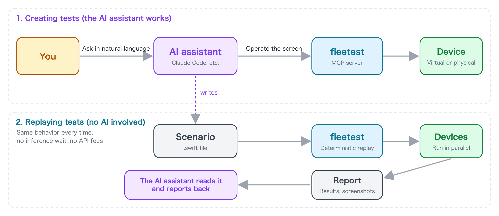

# Asking the AI assistant

[in Japanese(日本語)](asking_ai_ja.md)

fleetest is used by **asking an AI assistant such as Claude Code in natural language**. You do not need to read or write scenarios (the Swift files the AI assistant writes) or MCP tools yourself.
If you have not run anything yet, go through the [Quick Start](../quick-start.md) first.

## What you can ask for

- "In the fleetest test project myshop, create profiles for this app" → [Preparing the app and devices](preparing_app_and_devices.md)
- "In the fleetest test project myshop, create an exploratory test that covers only the login screen" → [Creating tests](creating_tests.md)
- "Put the server my app depends on in a container and declare it to fleetest" → [Preparing the servers your app depends on](preparing_app_server.md)
- "Run the scenarios you created on iOS" → [Running tests](running_tests.md)
- "Summarize the current run results. If there are failures, investigate the cause" → [Read results and investigate failures](investigating_failures.md)
- "I changed the design of the login screen, so fix the related tests" → [Keep tests up to date with app changes](keeping_up_with_app_changes.md)
- "Set up another Mac so it can be used as a runner machine" → [Remote Runners](../fleet/remote_runners.md)
- "Create a setup that runs this project's tests on Jenkins" → [Run in CI](../in_action/ci.md)

You can watch runs in the VSCode extension's device monitor ([Watch in VSCode](watching_in_vscode.md)).

## Patterns for asking

### 1. Narrow the target

Limit each request to one screen or one flow of operations.

```text
In the fleetest test project myshop, create an exploratory test that covers only the My Shop login screen.
```

### 2. Add the OS and device

Say whether it is iOS or Android. If you know the run profile name, writing it is the most reliable.

```text
In the fleetest test project myshop, with the run profile android-run, create an exploratory test that covers only the cart screen.
```

### 3. Write the completion condition

```text
... Stop once you've told me the file name of the new scenario. There's no need to run it on a device.
```

### 4. Make the request independent of the conversation

Instead of "with the app you just built", write concrete names such as the app name, app ID and screen name (the request then works pasted into a new session or a different AI assistant).

### 5. Keep the judgment with the human

Whether it is acceptable to rewrite the app's expected values when a test fails is for you to decide. Separate the investigation from the fix.

```text
Find out why the tests in the fleetest test project myshop failed and report back. Don't fix the scenario yet.
```

## How it works



AI is not used to replay a finished test (it behaves the same way every time). For details, see
[MCP server](../reference/tools/mcp_server.md) and [Claude Code skills](../reference/tools/claude_code_skills.md).

## AI assistants other than Claude Code

You can also use MCP-capable AI assistants such as Codex and Cline: [AI assistants other than Claude Code](../reference/tools/other_agents.md)

Next: [Preparing the app and devices](preparing_app_and_devices.md)

### Link
- [index](../index.md)
