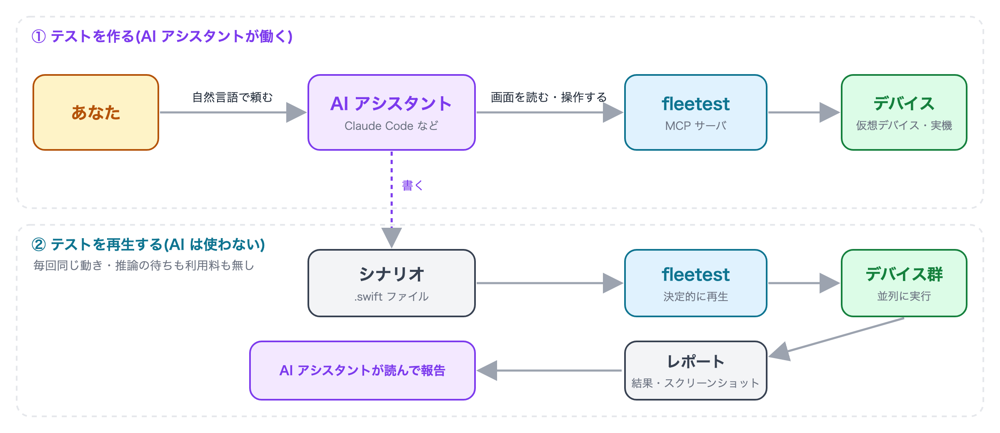

# AIアシスタントへの指示の仕方

[in English](asking_ai.md)

fleetest は、Claude Code などの AIアシスタントへ**自然言語で指示して**使います。シナリオ(AIアシスタントが書く Swift のファイル)や MCP のツールを、あなたが読み書きする必要はありません。
まだ一度も動かしていなければ、先に[クイックスタート](../quick-start_ja.md)を通してください。

## 指示できること

- 「fleetest のテストプロジェクト myshop に、このアプリのプロファイルを作って」 → [アプリとデバイスを用意する](preparing_app_and_devices_ja.md)
- 「fleetest のテストプロジェクト myshop で、ログイン画面だけを対象に探索的テストを作成して」 → [テストを作る](creating_tests_ja.md)
- 「アプリが依存するサーバーをコンテナにして、fleetest に宣言して」 → [アプリが依存するサーバーを用意する](preparing_app_server_ja.md)
- 「作成したシナリオを iOS で実行して」 → [テストを実行する](running_tests_ja.md)
- 「今の実行結果を要約して。失敗があれば原因を調べて」 → [結果を読み、失敗を調べる](investigating_failures_ja.md)
- 「ログイン画面のデザインを変えたので、関係するテストを直して」 → [アプリの変更にテストを追従させる](keeping_up_with_app_changes_ja.md)
- 「別の Mac をランナー機として使えるようにして」 → [リモート実行](../fleet/remote_runners_ja.md)
- 「このプロジェクトのテストを Jenkins で回す設定を作って」 → [CI で回す](../in_action/ci_ja.md)

実行の様子は、VSCode 拡張のデバイスモニターで見られます([VSCode で見る](watching_in_vscode_ja.md))。

## 指示の型

### 1. 対象を絞る

1回の依頼で扱うのは1画面か1つの操作の流れにします。

```text
fleetest のテストプロジェクト myshop で、My Shop のログイン画面だけを対象に、探索的テストを作成して。
```

### 2. OS とデバイスを添える

iOS か Android かを書きます。実行プロファイル名が分かっていれば、それを書くのが一番確実です。

```text
fleetest のテストプロジェクト myshop の実行プロファイル android-run で、カート画面だけを対象に探索的テストを作成して。
```

### 3. 完了条件を書く

```text
… 作成したシナリオのファイル名を報告したら終わりにして。デバイスでは実行しなくてよい。
```

### 4. 会話に依存しない文にする

「さっきビルドしたアプリで」ではなく、アプリの名前・アプリ ID・画面名など具体的な名前で書きます(新しいセッションや別の AIアシスタントに貼っても通じます)。

### 5. 判断は人が持つ

テストが落ちたときに、アプリの期待値を書き換えてよいかはあなたが決めます。調査と修正は分けて指示します。

```text
fleetest のテストプロジェクト myshop の失敗の原因を調べて報告して。シナリオはまだ直さないで。
```

## しくみ



できあがったテストの再生には AI を使いません(毎回同じ動きになります)。詳しくは
[MCP サーバー](../reference/tools/mcp_server_ja.md)・[Claude Code のスキル](../reference/tools/claude_code_skills_ja.md)。

## Claude Code 以外の AIアシスタント

Codex・Cline など MCP に対応した AIアシスタントでも使えます: [Claude Code 以外の AIアシスタント](../reference/tools/other_agents_ja.md)

次へ: [アプリとデバイスを用意する](preparing_app_and_devices_ja.md)

### Link
- [index](../index_ja.md)
