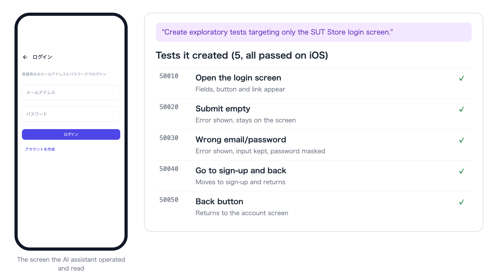

# Creating tests

[in Japanese(日本語)](creating_tests_ja.md)

You have an AI assistant create the tests. The result is a Swift file (scenario) under `TestProjects/myshop/scenarios/`.

## 1. Create an exploratory test

This suits your first test. You specify a screen and let the AI assistant decide what to check as well.

### Prompt for the AI

```text
In the fleetest test project myshop, create an exploratory test for just the My Shop login screen.
```

At the end of the work it runs the compile, the verification without a device (dry-run) and a run on a device, and reports the result.

What you'll see (an example with the sample app [SUT Store](https://github.com/wave1008/sut-ec-mobile)):




## 2. Turn a fixed procedure into a test

### Prompt for the AI

```text
In the fleetest test project myshop, create an iOS test for My Shop with these steps:
1. Open the first product in the product list
2. Tap "Add to cart"
3. Open the cart screen
Then check that the cart has 1 item, and that its name matches the product you opened from the list.
```

Always write the success condition (what must be visible for it to succeed).

## 3. Add to an existing test

### Prompt for the AI

```text
In the fleetest test project myshop, add a case to the My Shop login test: a password shorter than 8 characters should show an error message.
```

If the behavior you ask for is not in the app, the AI assistant reports the actual behavior and leaves the decision of whether that matches the specification to you.

## 4. Make a test that runs on both iOS and Android

This is for an app with the same screens and the same IDs (such as Compose Multiplatform, Flutter, or React Native).

### Prompt for the AI

```text
In the fleetest test project myshop, make the My Shop login test work on both iOS and Android, then run it on both to confirm.
```

## When a screen may or may not appear

Screens that sometimes appear and sometimes do not, such as first-launch guides, announcement dialogs, and OS permission dialogs, make tests unstable.
Put the dialog's name and the label of its close button in the prompt (and, if you can, a screenshot of the screen while it is shown).

### Prompt for the AI

```text
My Shop sometimes shows a "Spring campaign" dialog right after launch. "Close" at the top right dismisses it.
Update the login test in the fleetest test project myshop so that it closes the dialog when it appears, then continues.
```

## Finish a recorded scenario (VSCode)

A scenario created by recording has no "what must be visible for it to succeed", so have the AI assistant finish it.

### Prompt for the AI

```text
In the fleetest test project myshop, TestProjects/myshop/scenarios/Generated/ contains a scenario created by recording. Add checks for what's on screen to each test.
```

<details>
<summary><b>If you do it manually (click to show details)</b></summary>

In the "Live Control" tab of the VSCode extension's device monitor, press "Start Recording", operate the app shown on screen,
and then press "Stop Recording". For details, see [Watch in VSCode](watching_in_vscode.md).

</details>

## When it does not go well

- The work drags on or goes off track: narrow the target again to one screen or one flow, and write the completion condition.
- It is exploring on the wrong device: specify the run profile's name ("on the devices of ios-run").
- The test sometimes passes and sometimes fails: "Run this test 5 times, and if some runs fail, investigate the cause."
- Elements lower on the screen are not reached: "Make it reach elements that are only visible after scrolling."

More details: [Creating a test class](../reference/testclass/creating_testclass.md) · [Selector expressions](../reference/selector/selector_expression.md) · [Writing robust scenarios](../reference/writing/writing_robust_scenarios.md) · [How to write for each UI component, and its quirks](../reference/writing/ui_component_patterns.md)

Next: [Running tests](running_tests.md)

### Link
- [index](../index.md)
