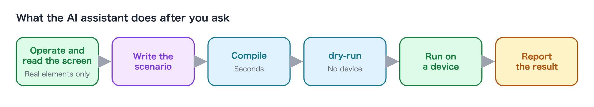

# Creating tests

[in Japanese(日本語)](creating_tests_ja.md)

You have an AI assistant create the tests. The result is a Swift file (scenario) under `TestProjects/project1/scenarios/`. You can try each step with the sample app (SUT Store).

## 1. Create a happy-path test

This suits your first test. It creates one test for the normal flow only (add error cases and the like later with "Add to an existing test").

### Prompt for the AI

```text
In the fleetest test project project1, create one happy-path test (the normal flow) for SUT Store.
Search for a product on the search screen (narrowing by category is fine), open it, add it to the cart, and check that the product is in the cart. No login is needed.
```

At the end of the work it runs the compile, the verification without a device (dry-run) and a run on a device, and reports the result.



## 2. Add to an existing test

### Prompt for the AI

```text
In the fleetest test project project1, add a case to the SUT Store happy-path test: without logging in, set the quantity to 3 in the product details and add it to the cart.
Check that the total in the cart is three times the unit price.
```

If the behavior you ask for is not in the app, the AI assistant reports the actual behavior and leaves the decision of whether that matches the specification to you.

More details: [Creating a test class](../reference/testclass/creating_testclass.md) · [Selector expressions](../reference/selector/selector_expression.md) · [Writing robust scenarios](../reference/writing/writing_robust_scenarios.md)

Next: [Running tests](running_tests.md)

### Link
- [index](../index.md)
