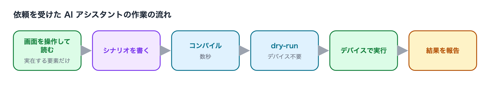

# テストを作る

[in English](creating_tests.md)

テストは AIアシスタントに作らせます。できあがるのは `TestProjects/myshop/scenarios/` 配下の Swift ファイル(シナリオ)です。

## 1. 基本ルートのテストを作る

最初の1本に向いています。正常に進む流れだけを1本作ります(エラーの場合などは、あとで「既存のテストに足す」で足します)。

### AIへの指示文

```text
fleetest のテストプロジェクト myshop で、My Shop のログイン画面の基本ルート(正常にログインできる流れ)のテストを1本作成して。
```

作業の最後に、コンパイルとデバイス無しの検証(dry-run)、デバイスでの実行まで行い、結果が報告されます。



## 2. 決まった手順をテストにする

### AIへの指示文

```text
fleetest のテストプロジェクト myshop に、My Shop の次の手順のテストを iOS 向けに作成して。
1. 商品一覧の先頭の商品を開く
2. 「カートに入れる」を押す
3. カート画面を開く
最後に、カートに 1 件入っていて、その商品名が一覧で開いた商品と同じであることを確かめて。
```

成功の条件(何が見えたら成功か)は必ず書きます。

## 3. 既存のテストに足す

### AIへの指示文

```text
fleetest のテストプロジェクト myshop の My Shop のログインのテストに、パスワードを 8 文字未満にしたときにエラーメッセージが出るケースを追加して。
```

指示した挙動がアプリに無いときは、実際の挙動が報告され、仕様どおりかの判断を求められます。

## 4. iOS と Android の両方で動くテストにする

同じ画面・同じ ID を持つアプリ(Compose Multiplatform・Flutter・React Native など)向けです。

### AIへの指示文

```text
fleetest のテストプロジェクト myshop の My Shop のログインのテストを iOS と Android の両方で動くように直し、両方のデバイスで実行して確かめて。
```

## 出るか分からない画面がある場合

初回起動の案内・お知らせのダイアログ・OS の許可ダイアログなど、出たり出なかったりする画面は、テストを不安定にします。
ダイアログの名前と閉じるボタンの文言を指示に入れます(分かれば出ているときの画面の写真も)。

### AIへの指示文

```text
My Shop は起動直後に「春のキャンペーン」というダイアログが出ることがある。右上の「閉じる」で閉じられる。
fleetest のテストプロジェクト myshop のログインのテストを、ダイアログが出たら閉じてから進むように直して。
```

## 録画してから仕上げる(VSCode)

録画で作ったシナリオには「何が見えたら成功か」が入らないので、AIアシスタントに仕上げさせます。

### AIへの指示文

```text
fleetest のテストプロジェクト myshop の TestProjects/myshop/scenarios/Generated/ に、録画で作ったシナリオがある。各テストに、画面に出ている内容の検証を足して。
```

<details>
<summary><b>手動で実行する場合(クリックで詳細表示)</b></summary>

VSCode 拡張のデバイスモニターの「ライブ操作」タブで「レコーディング開始」を押し、画面に映ったアプリを操作してから
「レコーディング終了」を押します。詳しくは[VSCode で見る](watching_in_vscode_ja.md)。

</details>

## うまくいかないとき

- 作業が長引く・脱線する: 対象を1画面・1つの流れに絞り直し、完了条件を書く。
- 違うデバイスで探索している: 実行プロファイル名を指定する(「ios-run のデバイスで」)。
- テストが通ったり落ちたりする: 「このテストを5回実行して、落ちる回があれば原因を調べて」
- 画面の下のほうの要素に届かない: 「スクロールしないと見えない要素にも届くようにして」

もっと詳しく: [テストクラスの作成](../reference/testclass/creating_testclass_ja.md)・[セレクタ式](../reference/selector/selector_expression_ja.md)・[壊れにくいシナリオの書き方](../reference/writing/writing_robust_scenarios_ja.md)・[UI 部品ごとの書き方と癖](../reference/writing/ui_component_patterns_ja.md)

次へ: [テストを実行する](running_tests_ja.md)

### Link
- [index](../index_ja.md)
