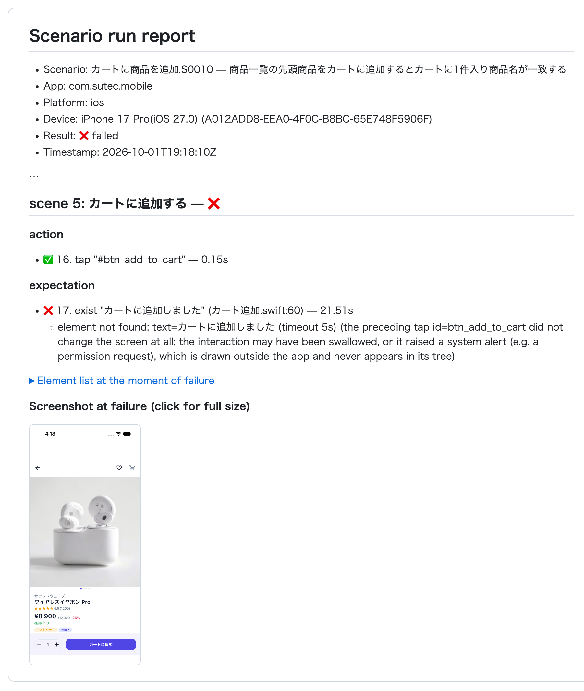

# Reading Results and Investigating Failures

[in Japanese(日本語)](investigating_failures_ja.md)

Every time you run tests, the results are kept, pass or fail. You can leave the reading to the AI assistant too.
What fleetest records is only the facts: at which stage, which operation, and how it failed. It does not jump to conclusions about causes.

## 1. Make one fail on purpose

To practice investigating, temporarily change an expected value in the add-to-cart test so that it fails.

### Prompt for the AI

```text
In the first test of the "add-to-cart test" (AddToCart.swift) of the fleetest test project project1, temporarily change just one expected value, the one that checks the product name in the cart, to a product name that does not exist.
Then run it on iOS (ios-run) and report only pass or fail. Don't fix it.
```

Expected result:

- The first test of the add-to-cart test fails.
- The other tests pass.

## 2. Have the results summarized

### Prompt for the AI

```text
Summarize the latest run of the fleetest test project project1. If anything failed, list the failed scenarios and the steps where they failed.
```

<details>
<summary><b>If you do it manually (click to show details)</b></summary>

- Each scenario has a Markdown report under `TestProjects/project1/reports/`.
- In VSCode, the Test Explorer shows pass/fail directly, and you can open the report from there.
  The command "fleetest: Open Results Dashboard" also shows the run history and success rate.

</details>
<br>

Expected result:

- The first test of the add-to-cart test is listed.
- The step where you changed the expected value is listed.

## 3. Have the cause investigated (don't fix it)

### Prompt for the AI

```text
Use the reports to find out why scenarios failed in the latest run of the fleetest test project project1, and report back.
For each one, say whether it looks like an app bug or a problem with how the test is written.
Don't fix the scenarios yet (and don't make them pass by adjusting expected values to match the app).
```

- Always add "don't fix them". If you ask for investigation and a fix at once, a test that failed because of an app bug may get made to pass by adjusting the expected value to match the app.
- Read the report first, then you decide whether to fix it.

Expected result:

- The report contains the failed step, the failure message, and the element list and screenshot at the moment of failure (below is from the sample app).
- This time it reports that the expected product name was not in the cart.



## 4. Restore it and re-run only what failed

### Prompt for the AI

```text
In the "add-to-cart test" (AddToCart.swift) of the fleetest test project project1, restore the expected value to the original product name, and re-run only the scenarios that failed on iOS last time.
```

<details>
<summary><b>If you do it manually (click to show details)</b></summary>

```bash
../foundation-tester/.build/debug/fleetest run --project project1 --profile ios-run --failed
```

Results are recorded per profile, so run it with the same profile as last time.

</details>
<br>

Expected result:

- Only the one test that had failed runs, and it passes.

More details:

- [Test result files](../reference/testclass/test_result_files.md)
- [Analyzing results](../reference/running/results_analysis.md)

<br>

Next: [Running smoke and regression separately](smoke_and_regression.md)

### Link
- [index](../index.md)
