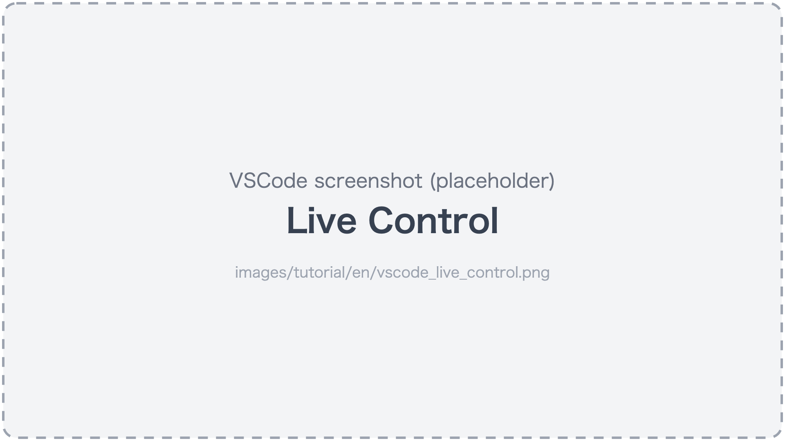
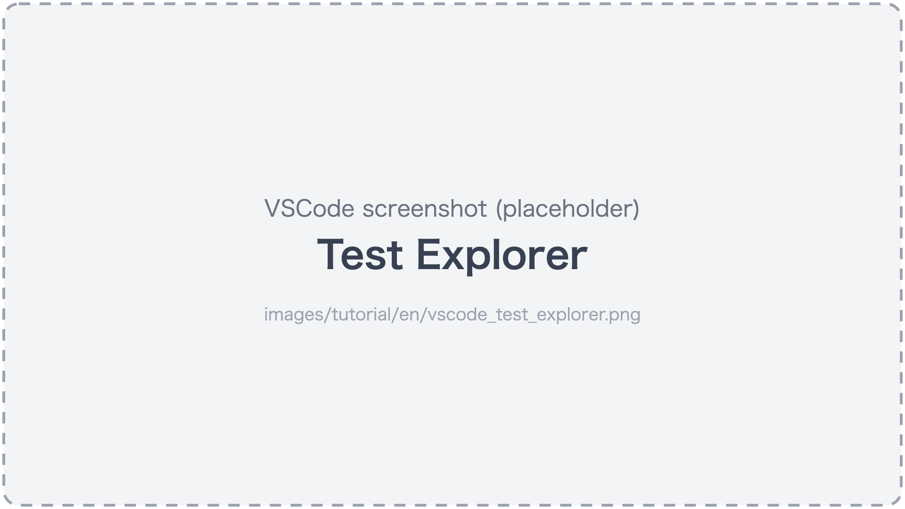
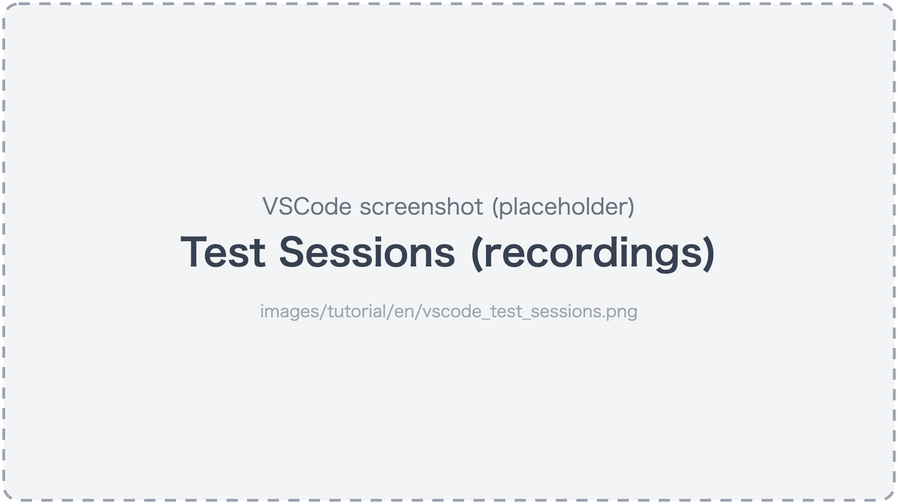

# Watching in VSCode

[in Japanese(日本語)](watching_in_vscode_ja.md)

While the AI assistant creates and runs tests, you can **watch** what is happening in the VSCode extension.
The VSCode extension comes with the installation in [Quick start](../quick-start.md).
This page walks you through it step by step and shows what you see on each screen.

## 1. Open the Device Monitor

Run "fleetest: Show Device Monitor" from the Command Palette, or click
**fleetest mobile** in the status bar at the bottom left of VSCode.

What you see:

- The "Device Monitor" tab opens with three panes, top to bottom: the **Line View** (the row of device tiles), the
  **Grid View** (the enlarged screen of the selected device) and the **Run Log View** (the run log of the selected
  device).
- The Line View shows the device screens in near real time. You can watch the AI assistant exploring, and tests
  running in parallel on multiple devices, as they happen.
- The "Running" section at the top shows the runs in progress, with "how many of how many" and "how many minutes left".


## 2. Select a tile to see the enlarged screen and the run log

Click a tile in the Line View to select the device. It is easiest to see when you try this while the AI assistant is
running a test.

```text
Run the scenario I created on iOS.
```

What you see:

- The selected device's screen appears enlarged in the Grid View.
- The Run Log View streams that device's run log (which step is running and whether it passed).
- The Grid View and the Run Log View show only the device selected in the Line View. With nothing selected, both say
  "Select a device".
- With exactly one device selected, the Grid View shows the enlarged screen and the run log side by side, and the Run
  Log View below folds itself so the same log is not shown twice.

## 3. Touch it yourself (Live Control)

Open the "Live Control" tab (you can also run "fleetest: Show Live Control" from the Command Palette).
You can operate the device screen directly with the mouse (click to tap, drag to swipe).
Use it when you want to check how the screen looks before asking the AI assistant, or to set up by hand the state a test assumes.

What you see:

- The place you click is tapped on the device, and the screen updates.

You can also turn your operations directly into a scenario with "Start Recording" -> operate -> "Stop Recording".
A scenario made by recording has no verifications in it, so ask the AI assistant to finish it
([Creating tests](creating_tests.md#creating-by-recording-vscode)).



## 4. Run from the Test Explorer

Open VSCode's Testing view. The project's scenarios appear in three levels: folder -> class -> test.

1. Choose a run profile with `fleetest: Select Run Profile` in the Command Palette
   (without one, the run does not start and shows an error).
2. Select a test and press "Run" or "Run (dry-run)".

What you see:

- Pass/fail is shown right there, and you can open the failure report from it.
- You can watch the running devices in the Device Monitor from steps 1 and 2.



## 5. Watch the recordings

Open the "Test Sessions" tab. Recording is on by default. If the Device Monitor is showing when a run finishes, it
switches to this tab automatically.

What you see:

- Each scenario's video and steps, to look back at.
- You can also export the results to an Excel file.

To save space, you can keep recordings only for failed scenarios.

### Prompt for the AI

```text
For fleetest's iOS runs, keep recordings only for failed scenarios.
```



## 6. See the Results Dashboard

Run "fleetest: Open Results Dashboard" from the Command Palette.

What you see:

- The run history, newly failing tests, recovered tests, and success rate.


## When the Mac is slow

Streaming the screens puts load on the Mac. When you are running many devices in parallel and things get slow,
turn "Live Updates" in the Device Monitor OFF to stop streaming and lower the load (status display continues).

## Learn more

See [VSCode extension](../reference/tools/vscode_extension.md) for all features and settings.

Next: [Network exposure and security](../security/network_security.md)

### Link
- [index](../index.md)
