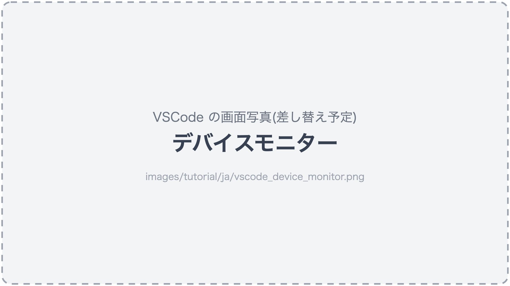
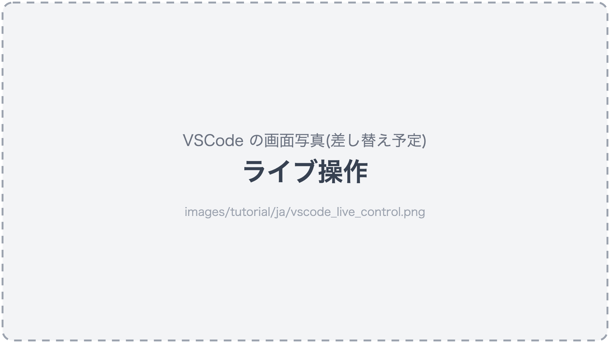
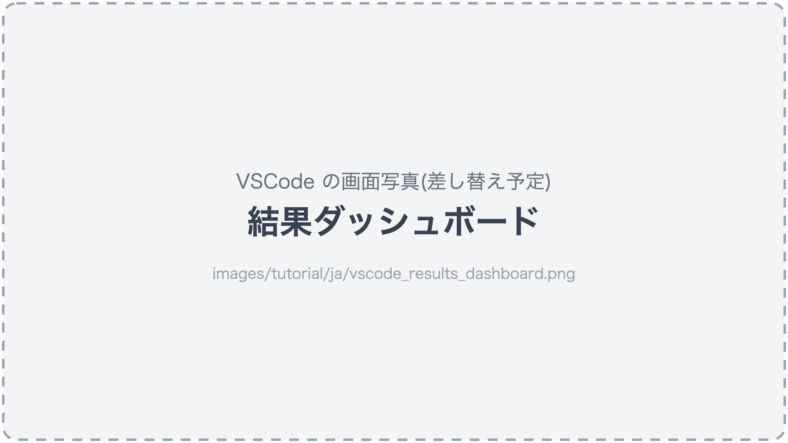

# VSCode で見る

[in English](watching_in_vscode.md)

AIアシスタントがテストを作り、実行している間の様子を、VSCode 拡張で見ます(拡張は[クイックスタート](../quick-start_ja.md)で入ります)。

## 1. デバイスモニターを開く

コマンドパレットで「fleetest: デバイスモニターを表示」を実行するか、VSCode 左下のステータスバーの **fleetest mobile** をクリックします。

見えるもの: 上から **ラインビュー**(デバイスのタイルの並び)・**グリッドビュー**(選択したデバイスの拡大表示)・
**実行ログビュー**(選択したデバイスの実行ログ)の3ペインと、実行中の本数・残り時間。



## 2. タイルを選んで拡大表示と実行ログを見る

ラインビューのタイルをクリックしてデバイスを選びます。AIアシスタントに次の指示を出している間に試すと分かりやすくなります。

### AIへの指示文

```text
fleetest のテストプロジェクト project1 で、カートに追加するテストを iOS の実行プロファイル ios-run で実行して。
```

見えるもの: 選んだデバイスの画面がグリッドビューに、実行ログが実行ログビューに出ます。何も選んでいないと「デバイスを選択して下さい」と出ます。

## 3. 自分の手で触る(ライブ操作)

「ライブ操作」タブ(コマンドパレットの「fleetest: ライブ操作を表示」)を開き、デバイスの画面をマウスで操作します(クリックでタップ・ドラッグでスワイプ)。

見えるもの: クリックした位置がデバイスでタップされ、画面が更新されます。

「レコーディング開始」→ 操作 →「レコーディング終了」で、操作をシナリオにできます。録画には検証が入らないので、仕上げは
AIアシスタントへ「録画で作ったシナリオの各テストに、画面に出ている内容の検証を足して」と指示します。



## 4. Test Explorer から実行する

VSCode の Testing ビューを開き、`fleetest: 実行プロファイルを選択` で使う実行プロファイルを選んでから、テストを選んで「実行」または「実行 (dry-run)」を押します。
実行プロファイルが1つしか無いときは、選ばなくても自動で選ばれます。

見えるもの: 成否がその場で出ます。失敗したテストからレポートを開けます。


## 5. 録画を見る

「テストセッション」タブを開きます(デバイスモニターを表示したまま実行が終わると、自動で切り替わります)。

見えるもの: シナリオごとの動画と手順。結果の Excel 書き出しもできます。

### AIへの指示文

```text
fleetest のテストプロジェクト project1 の iOS の実行で、失敗したシナリオの録画だけ残すようにして。
```


## 6. 結果ダッシュボードを見る

コマンドパレットで「fleetest: 結果ダッシュボードを開く」を実行します。

見えるもの: 実行の履歴・新たに落ちたテスト・回復したテスト・成功率。



## Mac が重いとき

たくさんのデバイスを並列に動かして重いときは、デバイスモニターの「ライブ更新」を OFF にします(画面の配信が止まり、状態の表示は続きます)。

もっと詳しく: [VSCode 拡張](../reference/tools/vscode_extension_ja.md)

次へ: [ネットワークの露出とセキュリティ](../security/network_security_ja.md)

### Link
- [index](../index_ja.md)
